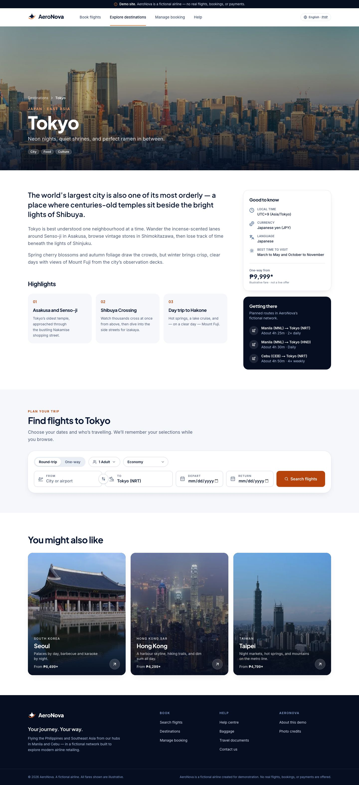
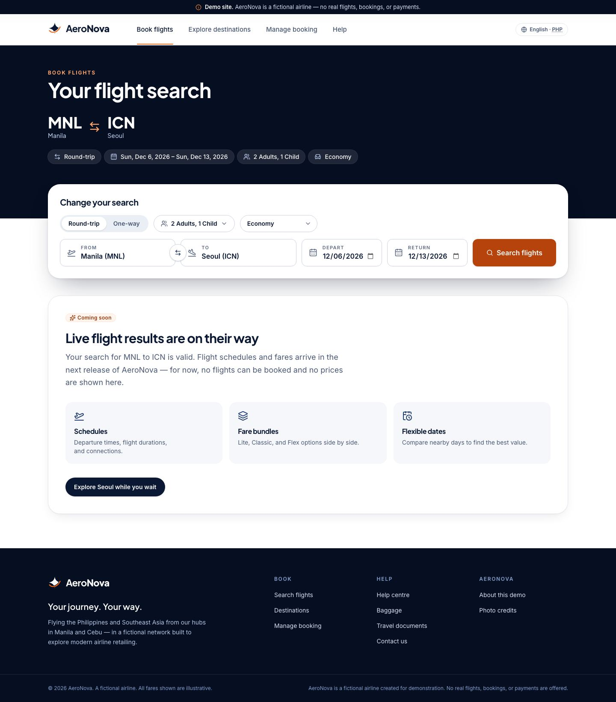
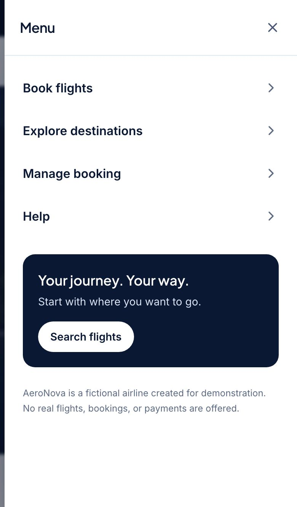
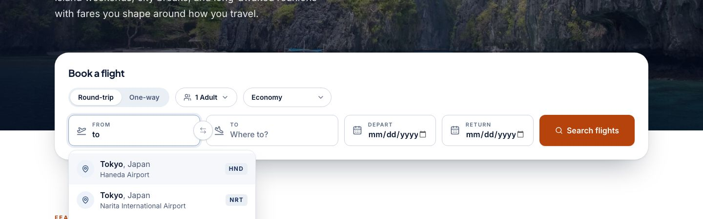

# AeroNova

**Your journey. Your way.**

AeroNova is a fictional airline and a modern airline retailing demo built with Next.js. It is
growing towards Offer & Order retailing: flight discovery, dynamic offers, fare bundles,
ancillaries, booking, and order management.

> AeroNova is not a real airline. It does not operate flights, sell tickets, or process payments.
> Airports and cities are real; the route network, schedules, and fares are invented. Any price
> shown is labelled as illustrative.


## Milestone status

| Milestone | Scope                                                             | Status         |
| --------- | ----------------------------------------------------------------- | -------------- |
| 1         | Monorepo foundation, premium storefront, search, destinations     | ✅ This branch |
| 2–7       | Inventory & offers → bundles → checkout → orders → accounts → ops | Planned        |
| 8         | NextRS runtime integration and compatibility                      | Planned (last) |

See [docs/ROADMAP.md](docs/ROADMAP.md) and the
[Milestone 1 report](docs/MILESTONE-1-REPORT.md).

**What works today:** homepage, flight search with airport autocomplete, URL-validated `/flights`
summary (results are explicitly “coming soon”), destination discovery with 12 guides, help,
and preview pages for features that don’t exist yet. Nothing on the site books a flight.

## Stack

Next.js 16.4 (App Router, Cache Components) · React 19 · TypeScript (strict) · Tailwind CSS 4 ·
Radix UI · Lucide · Zustand · React Hook Form · Zod · Axios (Fetch adapter) · Fastify 5 ·
Vitest · Playwright · pnpm workspaces · Turborepo

```text
apps/web             Next.js storefront
apps/retailing-api   Fastify mock retailing API (fixtures, no database)
packages/contracts   Shared Zod schemas, types, and pure domain rules
packages/ui          Design tokens and accessible UI primitives
packages/config      Shared TypeScript and ESLint configuration
tests/e2e            Playwright browser tests
```

Architecture, data flow, and the rendering strategy per route are in
[docs/ARCHITECTURE.md](docs/ARCHITECTURE.md).

## Getting started

Requires Node.js ≥ 22.22 and pnpm 10.

```bash
pnpm install
pnpm dev          # storefront on http://localhost:3000, API on http://127.0.0.1:4010
```

No API keys, paid services, or databases are needed. Configuration is optional; see
[`.env.example`](.env.example).

| Command          | What it does                                                       |
| ---------------- | ------------------------------------------------------------------ |
| `pnpm dev`       | Run the storefront and the mock API with hot reload                |
| `pnpm build`     | Production build (starts a temporary local API if none is running) |
| `pnpm lint`      | ESLint across all packages                                         |
| `pnpm typecheck` | `tsc --noEmit` across all packages and the E2E suite               |
| `pnpm test`      | Vitest unit, component, and integration tests                      |
| `pnpm test:e2e`  | Build, then run Playwright (desktop + mobile) on ports 3200/4210   |
| `pnpm format`    | Prettier                                                           |

First E2E run: `pnpm exec playwright install chromium`.

## Screenshots

| Destination guide                                              | Flight search summary                                   |
| -------------------------------------------------------------- | ------------------------------------------------------- |
|  |  |

| Mobile home                                      | Mobile menu                                      | Airport autocomplete                                       |
| ------------------------------------------------ | ------------------------------------------------ | ---------------------------------------------------------- |
|  |  |  |

## Credits and license

Photography comes from Wikimedia Commons under CC0, public-domain, CC BY, and CC BY-SA licences.
Attribution is listed on the site’s `/credits` page and in
[`apps/web/public/images/credits.json`](apps/web/public/images/credits.json).

Code is released under the [MIT License](LICENSE).
