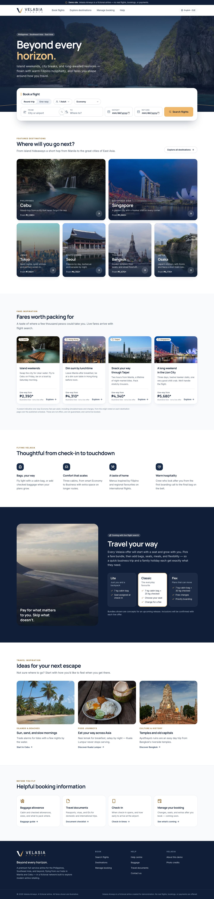
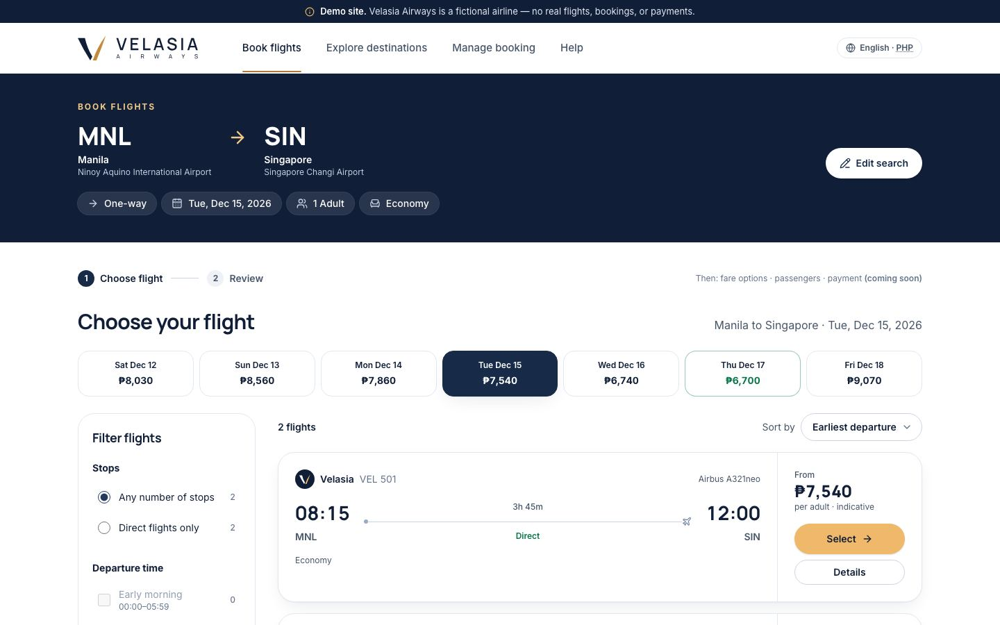
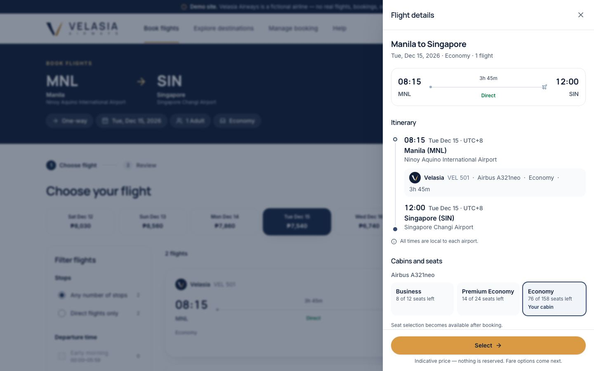
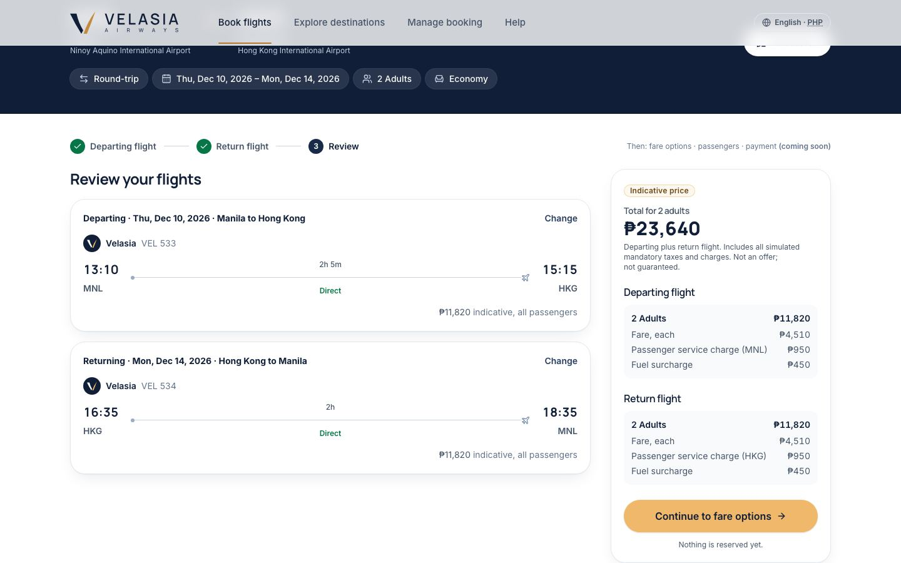
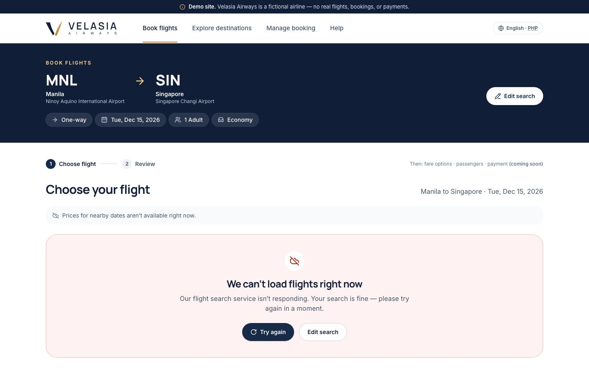
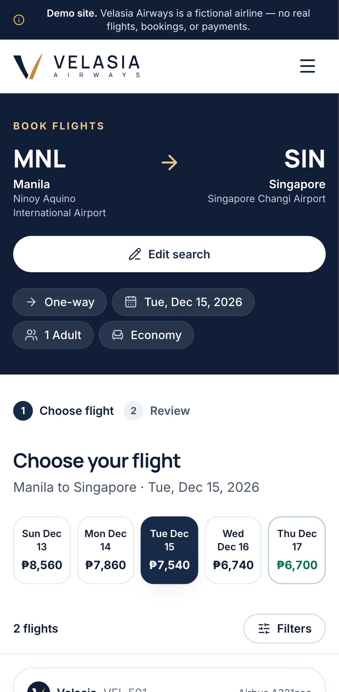
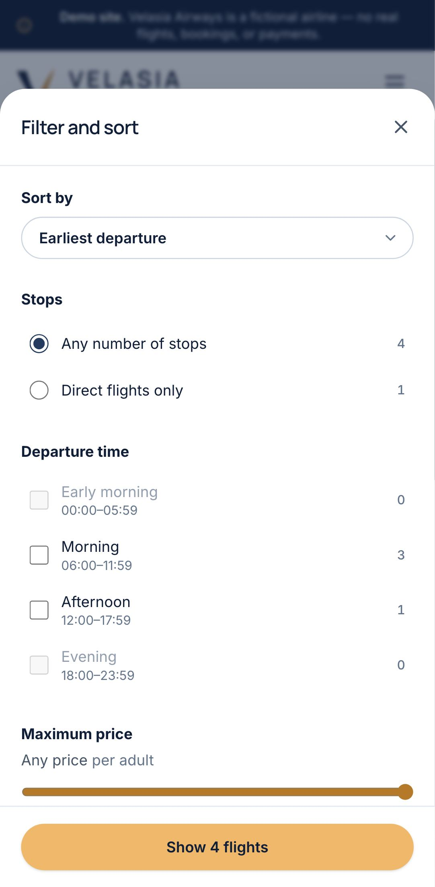
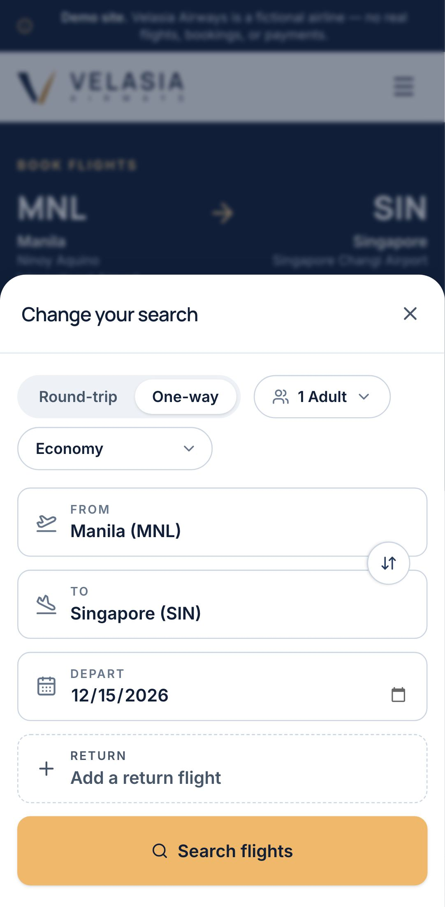
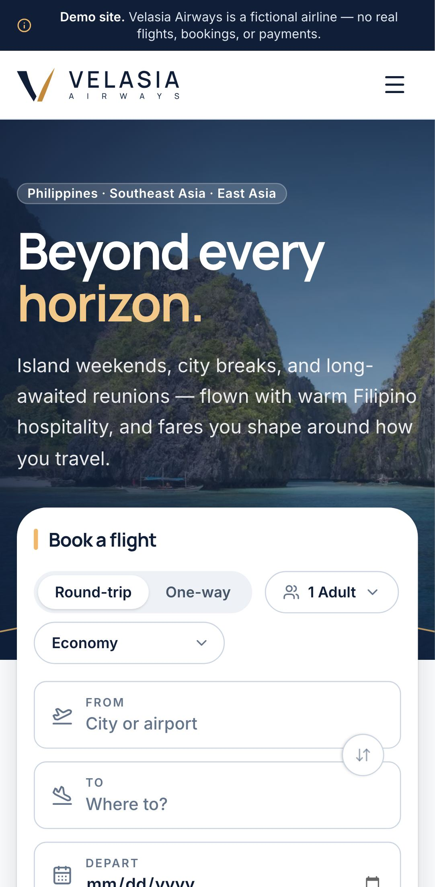

<p align="center">
  
</p>

# Velasia Airways

[](https://github.com/nextrs-sh/velasia-airways/actions/workflows/ci.yml)

**Beyond every horizon.**

A fictional premium airline retailing experience built with Next.js. Explore flight discovery,
dynamic offers, booking journeys, and modern Offer & Order retailing.

Velasia Airways is a modern, full-service airline headquartered (fictionally) in the
Philippines, flying across Southeast Asia and to selected international destinations, priced in
PHP. **Flight discovery and search are built today**; offers, booking, and order management are
planned milestones (see [status](#milestone-status)).

> Velasia Airways is not a real airline. It does not operate flights, sell tickets, or process
> payments, and it holds no IATA or ICAO airline designator: flight numbers such as `VEL 501`
> are a display convention for this demo. Airports and cities are real; the route network,
> schedules, and fares are invented. Any price shown is labelled as illustrative or indicative.



## Milestone status

| Milestone | Scope                                                         | Status         |
| --------- | ------------------------------------------------------------- | -------------- |
| 1         | Monorepo foundation, premium storefront, search, destinations | ✅ Done        |
| 2         | Flight inventory, dynamic search, indicative pricing          | ✅ Done        |
| 2.5       | Velasia Airways rebrand: identity, design system, API, docs   | ✅ Done        |
| 3–7       | Offers & bundles → checkout → orders → accounts → ops         | Planned        |
| 8         | NextRS runtime integration and compatibility                  | Planned (last) |

See [docs/ROADMAP.md](docs/ROADMAP.md) and the milestone reports:
[M1](docs/MILESTONE-1-REPORT.md), [M2](docs/MILESTONE-2-REPORT.md),
[M2.5](docs/MILESTONE-2.5-REBRANDING.md). M1 and M2 were delivered under the project's former
working name, AeroNova; their reports are kept as written.

**What works today:** search a fictional network of 21 airports and 54 routes, and get real
results from the Fastify retailing API. Results come from deterministic schedules and seat
inventory, with direct and one-stop itineraries and indicative prices that include simulated
taxes. One-way and round trips step through choosing a departing flight, a return flight, and a
review with a transparent total. You can filter by stops, departure time, price, and aircraft;
sort; browse nearby dates with their lowest fares; and open flight details with per-cabin seat
availability. Results stream into a server-rendered `/flights` page, and every empty and error
state is explained. There are also destination guides, help pages, and a clearly labelled
fare-selection preview. Nothing on the site books a flight.

## Flight search

- **Inventory.** 48 aircraft rotations (96 flight numbers) over 21 airports and four aircraft
  types — 562 departures a week, expanded into 9,628 dated flights over a 120-day horizon. Block times come from
  great-circle distance; local times are converted through each airport's IANA time zone.
  Load factors, demand, and cancellations are seeded and deterministic.
- **Search.** `GET /v1/flights` handles one-way and round-trip searches, cabins, passenger mixes,
  filters (stops, departure windows, price, aircraft), sort, and pagination. One-stop
  connections go through Manila or Cebu, with minimum and maximum connection times. Every
  empty result carries a reason: `no-route`, `cabin-not-offered`, `beyond-schedule`,
  `no-flights-on-date`, `insufficient-seats`, or `filtered-out`.
- **Pricing.** Indicative only, calculated by the API in integer minor units (PHP centavos).
  It depends on distance band, cabin, days to departure, demand band, weekday, season, and time
  of day, and adds simulated passenger service charges, fuel surcharges, and domestic VAT.
  Offers and fare families arrive in M3.
- **Network conditions.** Opt-in latency and per-request faults (`delay`, `timeout`,
  `unavailable`, `empty`, `malformed`) for testing the storefront against a failing service.

## Brand

The Velasia symbol is two swept wing blades forming a V on a shared horizon line; the trailing
blade, in Warm Gold, climbs past the frame. Midnight Navy carries the brand, gold is reserved for
selective emphasis, and booking screens stay on light, readable surfaces.

- Assets: [`apps/web/public/brand/`](apps/web/public/brand/) (SVG logos, favicon, app icons,
  social card)
- Usage, colour, typography, and clear space: [docs/BRAND-GUIDELINES.md](docs/BRAND-GUIDELINES.md)
- Single source of truth for the airline's name, tagline, currency, and flight-number display:
  `airline` in [`packages/contracts/src/airline.ts`](packages/contracts/src/airline.ts), also
  served by the API at `GET /v1/airline`

## Stack

Next.js 16.4 (App Router, Cache Components) · React 19 · TypeScript (strict) · Tailwind CSS 4 ·
Radix UI · Lucide · Zustand · React Hook Form · Zod · Axios (Fetch adapter) · Fastify 5 ·
Vitest · Playwright · pnpm workspaces · Turborepo

```text
apps/web             Next.js storefront
apps/retailing-api   Fastify mock retailing API (fixtures + deterministic inventory, no database)
packages/contracts   Shared Zod schemas, types, and pure domain rules
packages/ui          Design tokens and accessible UI primitives
packages/config      Shared TypeScript and ESLint configuration
tests/e2e            Playwright browser tests
```

Architecture, data flow, and the rendering strategy per route are in
[docs/ARCHITECTURE.md](docs/ARCHITECTURE.md).

## Getting started

Requires Node.js ≥ 22.22 and pnpm 10.

```bash
pnpm install
pnpm dev          # storefront on http://localhost:3000, API on http://127.0.0.1:4010
```

No API keys, paid services, or databases are needed. Configuration is optional; see
[`.env.example`](.env.example).

| Command          | What it does                                                       |
| ---------------- | ------------------------------------------------------------------ |
| `pnpm dev`       | Run the storefront and the mock API with hot reload                |
| `pnpm build`     | Production build (starts a temporary local API if none is running) |
| `pnpm lint`      | ESLint across all packages                                         |
| `pnpm typecheck` | `tsc --noEmit` across all packages and the E2E suite               |
| `pnpm test`      | Vitest unit, component, and integration tests                      |
| `pnpm test:e2e`  | Build, then run Playwright (desktop + mobile) on ports 3200/4210   |
| `pnpm format`    | Prettier                                                           |

To try slow responses locally, run the API with `RETAILING_API_LATENCY_MS=300-1200`. For
repeatable prices and seats, set `VELASIA_TODAY=2026-12-01` for both the API and the
storefront.

First E2E run: `pnpm exec playwright install chromium`.

## Screenshots

| Flight results                                                  | Flight details                                                 |
| --------------------------------------------------------------- | -------------------------------------------------------------- |
|  |  |

| Round-trip review                                        | API unavailable                                            |
| -------------------------------------------------------- | ---------------------------------------------------------- |
|  |  |

| Mobile results                                         | Mobile filters                                         | Mobile edit search                                             |
| ------------------------------------------------------ | ------------------------------------------------------ | -------------------------------------------------------------- |
|  |  |  |

| Destination guide                                              | Mobile home                                      |
| -------------------------------------------------------------- | ------------------------------------------------ |
|  |  |

## Credits and license

Photography comes from Wikimedia Commons under CC0, public-domain, CC BY, and CC BY-SA licences.
Attribution is listed on the site’s `/credits` page and in
[`apps/web/public/images/credits.json`](apps/web/public/images/credits.json).

Code is released under the [MIT License](LICENSE).
