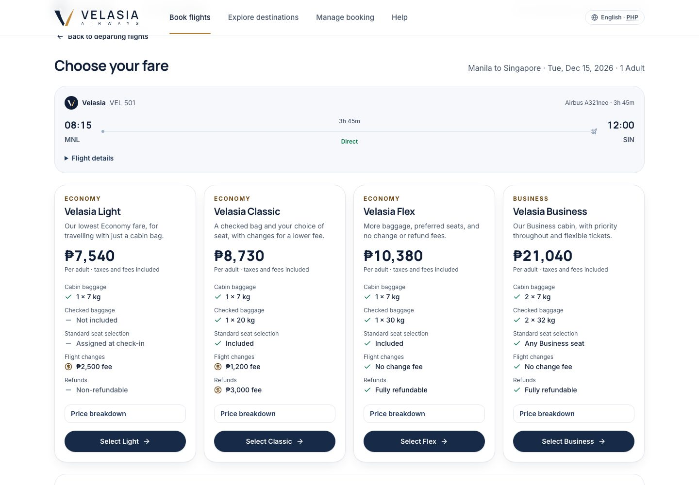
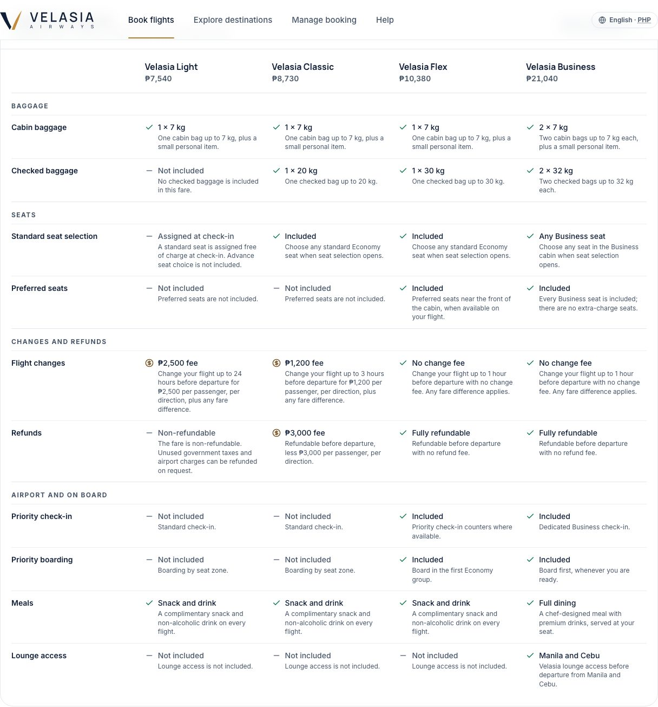
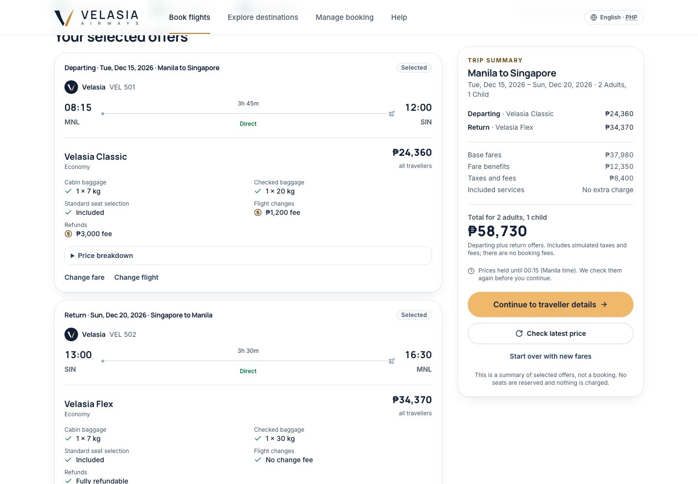
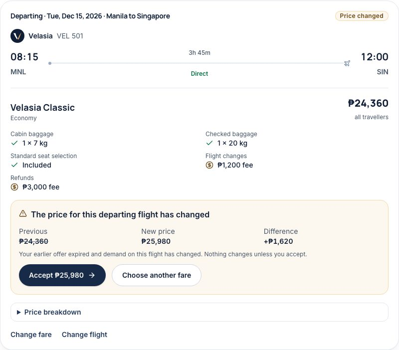
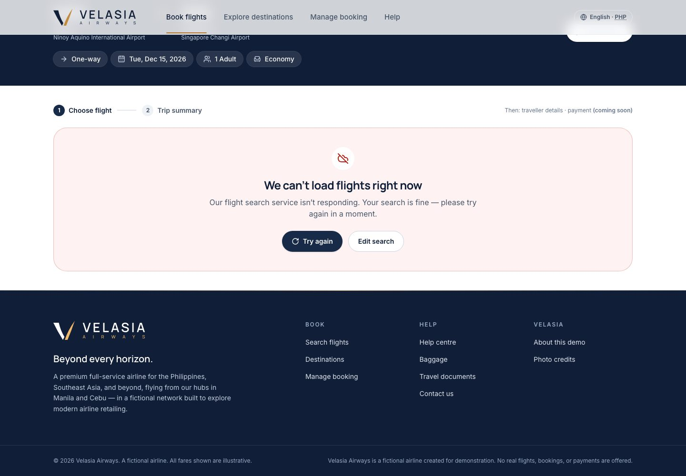
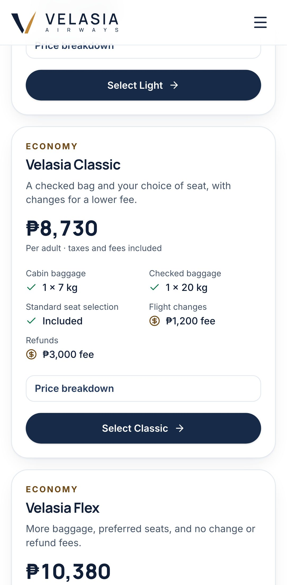
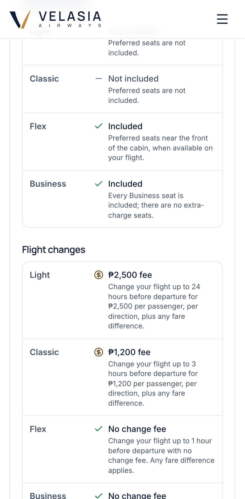
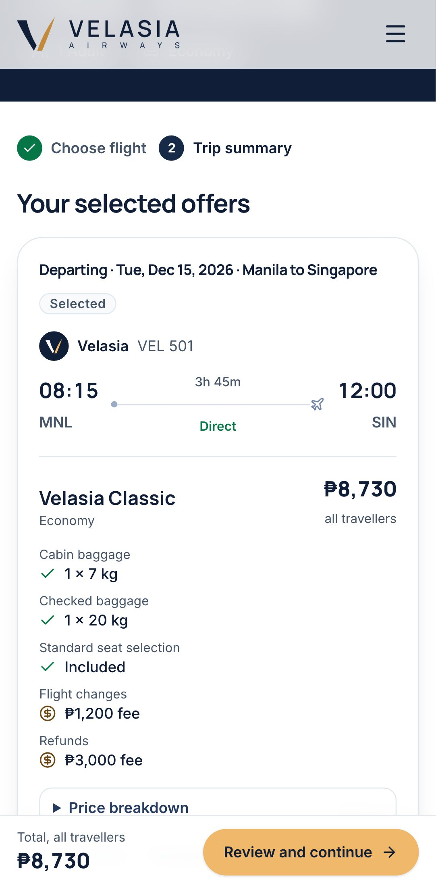

# Milestone 3 report: Dynamic offers, fare families & retailing

Branch `feat/m3-dynamic-offers-retailing`, based on `main` after M2 (PR #2) and the M2.5 rebrand
(PR #3) were merged. Runtime: official Next.js 16.4 on Node.js. No NextRS, no database, no
TalaDB, no real airline APIs, no payments.

Velasia's search now leads into **offers**: priced, time-limited propositions for a specific
itinerary, fare family, and party, created by the retailing API. Travellers compare fare
families, choose one per direction through Server Actions, and review a server-priced trip
summary that is re-validated before they continue. Nothing is booked: the milestone stops at a
clearly labelled "Traveller details" boundary.

The model is inspired by modern airline retailing (offers, offer items, expiry, repricing). It
doesn't implement IATA NDC or ONE Order schemas and claims no compliance with them.

## Features implemented

- **Fare families.** Velasia Light, Classic, Flex, and Business are structured products: a cabin,
  ten typed services (baggage with pieces and kilograms, seats, changes and refunds with their
  fees, priority, meals, lounge), and a price component. All rules are fictional.
- **Offer engine (Fastify).** It generates an offer for every family that can be sold on a real
  itinerary for the party. A family is withheld, with a stated reason, when an aircraft lacks its
  cabin or the cabin can't seat everyone. Pricing is deterministic and itemised, and offers
  expire after 15 minutes.
- **Shopping sessions.** These are server-side, bounded, in-memory sessions tied to a guest by a
  secret bearer token kept in an HTTP-only cookie. They support select, change family, change
  flight (an incompatible return is cleared, never the departure), re-validate, accept a changed
  price, and delete.
- **Storefront.** Every result card offers "View fares", which opens a server-rendered fare step
  showing:
  - the itinerary (with flight details);
  - rich fare cards with the price for the whole party and key inclusions;
  - unavailable families, each with its reason;
  - a per-card price breakdown;
  - an optional comparison matrix (a table on desktop, one list per feature on phones).
- **Round trips.** The flow runs departing flight → departing fare → return flight (with the
  chosen departure and its fare on top) → return fare → trip summary. Each direction can use a
  different family.
- **Trip summary.** Built from the session:
  - per-leg cards with lifecycle status and notices (fare changed, offer refreshed, price hold
    ended, price changed with explicit acceptance, flight no longer available);
  - a sticky summary panel with server totals and a mobile bottom bar;
  - "Continue to traveller details", "Check latest price", and "Start over".
- **Milestone boundary.** `/booking/travellers` is reachable only once every offer is
  re-validated. It collects no personal data and states that nothing is booked or charged.
- **Deterministic scenarios.** `offer-expired`, `price-increase`, `sold-out`, and
  `session-expired` are driven by a test-only header or cookie, next to M2's fault injection.

## API endpoint changes

| Service | Endpoint                                   | Notes                                                                             |
| ------- | ------------------------------------------ | --------------------------------------------------------------------------------- |
| Fastify | `GET /v1/fare-families`                    | Catalogue without prices; public cache headers                                    |
| Fastify | `GET /v1/offers`                           | `itineraryId, adults, children, infants, cabin`. Offers plus unavailable families |
| Fastify | `GET /v1/offers/:offerId`                  | Offer with derived status `AVAILABLE \| EXPIRED \| UNAVAILABLE`                   |
| Fastify | `GET /v1/offers/:offerId/price`            | Price against current rules; creates nothing                                      |
| Fastify | `POST /v1/shopping-sessions`               | `{ search }` → `{ session, token }` (201); token shown once                       |
| Fastify | `GET /v1/shopping-sessions/:id`            | `Authorization: Bearer <token>`                                                   |
| Fastify | `POST /v1/shopping-sessions/:id/select`    | `{ direction, offerId }`, strict (there is no field for a price)                  |
| Fastify | `POST /v1/shopping-sessions/:id/reprice`   | `{ directions? }` → per-direction outcomes                                        |
| Fastify | `DELETE /v1/shopping-sessions/:id`         | 204                                                                               |
| Next.js | `GET /api/fare-families`                   | Cached (`use cache`, prerendered, revalidated hourly)                             |
| Next.js | `GET /api/offers`, `/api/offers/[offerId]` | Validated, rebuilt upstream queries; `private, no-store`                          |
| Next.js | Server Actions                             | `selectOfferAction`, `checkSelectionAction`, `clearSelectionAction`               |

`GET /v1/offers` is a GET even though it stores offers. Repeating it within a minute returns
the same offers, and the store is bounded, so it is safe to retry and never reserves anything.
A POST "shop" endpoint wasn't needed because the query is small.

New error codes: `OFFER_NOT_FOUND` (404), `OFFER_EXPIRED` (410), `OFFER_UNAVAILABLE` (409),
`INVALID_SELECTION` (422), `SESSION_NOT_FOUND` (404, also returned for a wrong token), and
`SESSION_EXPIRED` (410). Errors never include stack traces or internal fields.

## New shared contracts

`packages/contracts/src/offers.ts` defines fare family codes and `SERVICE_ROWS` (the matrix
rows), typed services (`included | fee | not-included`, allowance, fee, summary, detail), the
offer, the per-passenger price (base fare, fare-family component, itemised taxes, unit and
subtotal), status, unavailable reasons, and the offer query codec.
`packages/contracts/src/shopping.ts` defines the session, the selection with its lifecycle
status, the last check, the previous choice, and any pending offer; the server-computed
summary; strict request schemas; and `requiredDirections` / `sameSearch`. The `/flights` URL
gains `fares=<itinerary>`, meaning "comparing fares for this flight in the current step".

## Offer lifecycle

```text
GENERATED → AVAILABLE ──select──▶ SELECTED ──reprice──▶ VALIDATED
                │                     │                     │
            (15 min)              (expiry)              (expiry)
                ▼                     ▼                     ▼
             EXPIRED               EXPIRED ──reprice──▶ REFRESHED (same price → VALIDATED)
                                                     └─▶ PRICE_CHANGED (pending offer; traveller
                                                          must accept, or choose again)
       any state ──flights unsellable──▶ UNAVAILABLE
```

- Offers are immutable. `EXPIRED` and `UNAVAILABLE` are derived when the offer is read, using
  the API's clock and the current inventory. An offer priced against an older inventory snapshot
  counts as expired.
- A valid offer keeps its price until it expires. Re-validation never changes a price silently:
  if a fresh offer costs the same, it replaces the old one and the traveller is told; if it
  costs a different amount, it waits as `pendingOffer`, the summary keeps showing the accepted
  total, and "Continue" is blocked until the traveller accepts or chooses again.
- The storefront shows when the price hold ends ("held until 00:15, Manila time"), measured from
  the API's `serverTime` rather than the browser clock, with no ticking countdown or urgency
  copy. The API enforces expiry whatever the page shows.

## Fare family rules (fictional)

| Service         | Light                         | Classic                 | Flex                       | Business                   |
| --------------- | ----------------------------- | ----------------------- | -------------------------- | -------------------------- |
| Cabin           | Economy                       | Economy                 | Economy                    | Business                   |
| Cabin baggage   | 1 × 7 kg                      | 1 × 7 kg                | 1 × 7 kg                   | 2 × 7 kg                   |
| Checked baggage | Not included                  | 1 × 20 kg               | 1 × 30 kg                  | 2 × 32 kg                  |
| Standard seat   | Assigned at check-in          | Included                | Included                   | Any Business seat          |
| Preferred seats | —                             | —                       | When available             | Included                   |
| Changes         | ₱2,500 + fare difference, 24h | ₱1,200 + difference, 3h | No fee, difference applies | No fee, difference applies |
| Refunds         | Non-refundable (taxes back)   | ₱3,000 fee              | Fully refundable           | Fully refundable           |
| Priority        | —                             | —                       | Check-in and boarding      | Check-in and boarding      |
| Meals           | Snack and drink               | Snack and drink         | Snack and drink            | Full dining                |
| Lounge          | —                             | —                       | —                          | Manila and Cebu            |

Business is offered only when **every** aircraft on the itinerary has a Business cabin with
enough seats for the party. The A320neo has none, so on MNL → CEB VEL 103 Business is shown as
"not offered on this flight" and is never swapped for another family. Premium Economy has no
fare family yet; a search in that cabin shows the Economy and Business fares with a notice.

## Pricing model and examples

Per flight, per passenger type (integer pesos, then minor units):

```text
base       = M2 segment fare (distance band, cabin, advance purchase, demand band, weekday,
             season, time of day; ₱10-rounded) × 0.9 if connecting
family     = round10(base × rate + fixed[distance band])
             Light 0 · Classic 12% + ₱300/450/600 · Flex 30% + ₱700/1,000/1,400 · Business 0
passenger  = round10(base × share) + round10(family × share)       share: adult 1, child 0.75, lap infant 0.1
taxes      = passenger service charge + fuel surcharge (seated passengers only)
             + 12% VAT on (base + family) for domestic flights
total      = Σ types count × Σ flights (passenger + taxes)
```

- The fare-family component is the price of the product, and it is shown as its own line. Included
  services then appear as "No extra charge", so nothing is counted twice.
- **Light equals the M2 indicative price exactly**, because both use the same per-passenger function
  (`pricePassengerType`). The "From" price on a result card is therefore the Light offer, and a
  test checks this across direct and connecting itineraries and mixed parties.
- There are no per-booking charges, so a round-trip total is exactly the sum of the two offers;
  the API computes it in the session summary.
- Integer arithmetic only. An invariant check rejects negative or non-integer amounts and
  components that don't add up to the total.
- `PRICING_VERSION = 2026-11.m3`. `demandShift` (test scenarios only) moves a flight up a demand
  band.

Examples (pinned "today" 2026-12-01, 15 Dec departures, one adult, totals with taxes):

| Itinerary                        | Light   | Classic | Flex    | Business    |
| -------------------------------- | ------- | ------- | ------- | ----------- |
| MNL → SIN, VEL 501 (A321neo)     | ₱7,540  | ₱8,730  | ₱10,380 | ₱21,040     |
| MNL → CEB, VEL 101 (A321neo)     | ₱3,488  | ₱4,193  | ₱5,190  | ₱9,435      |
| MNL → CEB, VEL 103 (A320neo)     | ₱3,656  | ₱4,384  | ₱5,403  | Not offered |
| DVO → SIN via MNL, VEL 122 + 503 | ₱10,525 | ₱12,361 | ₱14,916 | ₱28,209     |

MNL → SIN Classic: base ₱6,140; Classic component round10(6,140 × 12% + ₱450) = ₱1,190; taxes
₱950 passenger service charge + ₱450 fuel surcharge = ₱1,400 (international, so no VAT); total
₱8,730. A round trip for 2 adults and 1 child, with Classic out (₱24,360) and Flex back
(₱34,370), totals ₱58,730.

## Render strategy

- `/flights` stays a partial prerender. The fare step (`fares=`) and the trip summary each stream
  behind their own `<Suspense>` boundary with a skeleton. The fare step loads offers, the guest's
  session, and the cached fare family catalogue **in parallel**; the summary reads only the
  session (one API call, because offers embed their itinerary). The selected departure on the
  return step streams separately. The session is read once per request (`React.cache`) and
  shared by every section.
- Server Components render all fare and summary content. The client components are leaves:
  `SelectFareForm` (`useActionState`), `TripActions`, `CompareFares` (a toggle backed by a
  Zustand store, so the comparison stays open from departing to return fares), and
  `OfferValidity`. Prices are never kept in client state.
- Forms work before hydration (progressive enhancement). A successful selection redirects in the
  same round trip. Price checks call `refresh()` so the summary re-renders from the session.
- Caching: fare family descriptions use `use cache` + `cacheLife('hours')` +
  `cacheTag('fare-families')`. Offers, sessions, and validations are `no-store` and live outside
  any cached scope. No `updateTag` is needed, because no tagged cached resource changes when a
  guest selects something.
- `/booking/travellers` is a partial prerender: a static shell plus a session-dependent section.
  `app/flights/error.tsx` catches unexpected failures in the booking steps; expected failures
  (API down, timeout, expired offer) render in place.

## Test results

Run locally on macOS, Node 22.22, on 2026-11-15. E2E used the pinned "today" 2026-12-01.

| Command                                          | Result                                                                                                                                                                              |
| ------------------------------------------------ | ----------------------------------------------------------------------------------------------------------------------------------------------------------------------------------- |
| `pnpm format:check`                              | Clean                                                                                                                                                                               |
| `pnpm lint`                                      | 4/4 packages, 0 errors, 0 warnings                                                                                                                                                  |
| `pnpm typecheck`                                 | 4/4 packages + E2E suite, 0 errors                                                                                                                                                  |
| `pnpm test`                                      | **344 passed**: contracts 81, retailing-api 172, web 91 (M2: 228)                                                                                                                   |
| `pnpm build` (web)                               | Succeeds; route table in [ARCHITECTURE.md](ARCHITECTURE.md#rendering)                                                                                                               |
| `pnpm exec playwright test`                      | **62 passed**, 8 skipped (mobile-only tests in the desktop project), 0 failed. Earlier `--repeat-each 2` of the whole suite: 123 passed, 1 failed (the pre-existing M1 flake below) |
| `playwright test offers.spec.ts --repeat-each 4` | 56 passed, 0 failed (after the two fixes below)                                                                                                                                     |

Coverage:

- **Unit (API):**
  - fare family definitions and differences;
  - eligibility (no cabin, too few seats, lap infants, sales closed, cancelled, sold out);
  - Light equal to the indicative price;
  - family ordering and the documented formula;
  - domestic VAT on the family component;
  - passenger quantities, rounding, determinism, demand shift, and round-trip sums;
  - price invariants, the offer lifecycle, and bounded-store caps and expiry.
- **API integration:**
  - the fare family catalogue and offer search;
  - unavailable families, offer reuse, and determinism across instances;
  - invalid queries, 404/503, and malformed responses;
  - offer reads, statuses, and price checks;
  - session creation, validation, and token isolation;
  - selecting and changing families, ignoring client prices, and mismatched route, party, or
    direction;
  - expired and unavailable offers, round trips, and a same-day return clearing or rejecting;
  - repricing (validated, refreshed, price changed then accepted, unavailable with the other leg
    kept);
  - session expiry, delete, 9 concurrent mutations applied atomically, and memory caps.
- **Next.js integration:**
  - Route Handlers: cache headers, byte-identical prices, validation before any upstream call, and
    error mapping;
  - Server Actions against a real API, with a cookie jar per guest: HTTP-only cookie flags,
    redirects through each step, form price fields ignored, family changes, round trips, input
    validation, expired, unavailable, and mismatched offers (with `refresh`), API down, new search
    → new session;
  - guest isolation including a tampered cookie;
  - continue-only-when-validated, price-change review, session expiry, and clear;
  - component tests for the matrix, fare card, and breakdown.
- **E2E:**
  - Search MNL → SIN, open fares, compare Light, Classic, and Flex (the Light price equals the
    result card's "From" price), select Classic, check the breakdown, change to Flex, and see the
    new total.
  - Round trip with Classic out and Flex back, a combined total, and refresh restoring the
    selection.
  - Business not offered on an A320neo.
  - Expired offer refreshed with a notice, then continue.
  - Price change requiring acceptance.
  - Sold-out leg with the other leg kept.
  - Session expiry recovery.
  - A second browser can't see the first one's selection.
  - Offers API 503 with an accessible alert and retry, a failed selection, and a timeout.
  - axe on the fare step (matrix open), the summary, and the travellers page.
  - Keyboard-only compare and choose.
  - Mobile comparison without overflow.
  - No hydration errors.
  - No order, payment, or checkout request, and no input fields on the boundary page.
  - M1 and M2 specs updated for the new flow and all passing.

**Fixed during verification:**

- Flight numbers in `ink-subtle` failed contrast on tinted panels; they now use `ink-muted`.
- Two test defects (a renamed toggle, and an axe scan racing the title update after a Server
  Action redirect).
- One long test hit its 30 s limit under load and was split.

**Intermittent failure (pre-existing):**

- M1's destinations accessibility test timed out once in 140 runs. M2 recorded the same flake;
  it is unrelated to M3.

## Screenshots

Captured from the production build with the pinned date (`docs/screenshots/`):

| Fare comparison (desktop)                             | Comparison matrix                                       |
| ----------------------------------------------------- | ------------------------------------------------------- |
|                |      |
| **Round-trip summary, Classic out / Flex back**       | **Price change awaiting acceptance**                    |
|  |  |
| **Offers API unavailable**                            | **Mobile fares**                                        |
|    |            |
| **Mobile comparison (per-feature lists)**             | **Mobile trip summary with bottom bar**                 |
|   |   |

## Performance observations

Measured locally on a production build (not a benchmark):

- `GET /v1/offers` takes about 2–6 ms in-process. A fares page renders in 50–75 ms.
- A selection (Server Action → API → redirect render) has a median of about 220 ms once the page
  is hydrated. Clicks before hydration use the no-JS form POST and take about 1 s.
- The fares page is 332 KB uncompressed and 42.6 KB gzipped, compared with 33.8 KB gzipped for
  M2 results. Most of the extra is the comparison matrix, which is rendered for both layouts and
  includes every condition.
- Repeated offer requests within 60 s reuse the same offers instead of creating new ones. Offers
  (20,000) and sessions (5,000) are capped, with expired entries swept.

## Known limitations

- Single API instance with in-memory offers and sessions: a restart clears them, and several
  instances would not share them. The storefront then shows the "choose your fares" recovery.
  Durable, shared storage is planned with TalaDB.
- One active shopping session per browser: a new search replaces it, so two tabs with different
  searches overwrite each other's selection.
- There is no Premium Economy fare family; that cabin falls back to Economy and Business fares
  with a notice.
- Fees and allowances are fictional, fixed amounts, independent of route.
- With a pinned "today", the API's clock stays at midnight, so price holds show as "until 00:15"
  and never end naturally; the scenarios simulate time passing.
- The trip summary uses the session's itineraries. If the URL points to different ones (for
  example, an old history entry), it says so and shows the current selection.

## Deferred

Seat maps and paid seats, extra baggage, meals, passenger forms, reservation holds, checkout,
payment, orders, refunds, loyalty, TalaDB persistence, and NextRS (last milestone).

## Recommendations for Milestone 4

1. Turn a re-validated session into an **order** in a TalaDB-backed store. Make
   `/booking/travellers` collect traveller details against `requiredDirections` and the session's
   passenger mix.
2. Add an inventory **hold** at order creation, the first time seats are actually decremented, and
   recheck `OFFER_UNAVAILABLE` there.
3. Move sessions to the same store, so several API instances share them, and drop the
   one-session-per-browser limit by keying sessions to the search.
4. Price ancillaries (bags, seats) as additional offer items on top of the fare family's included
   services, reusing `OfferService` and the breakdown component.
5. Add a Premium Economy family once that cabin's product is defined.
