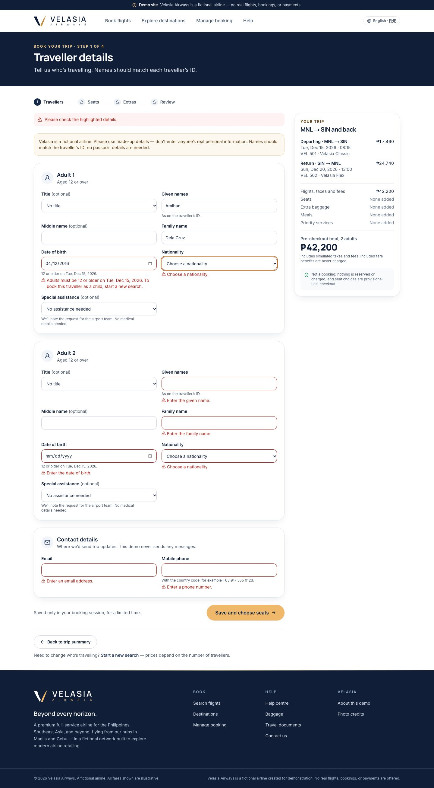
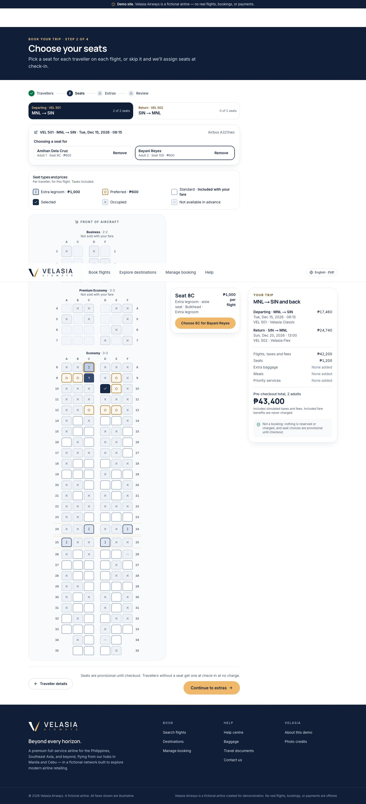
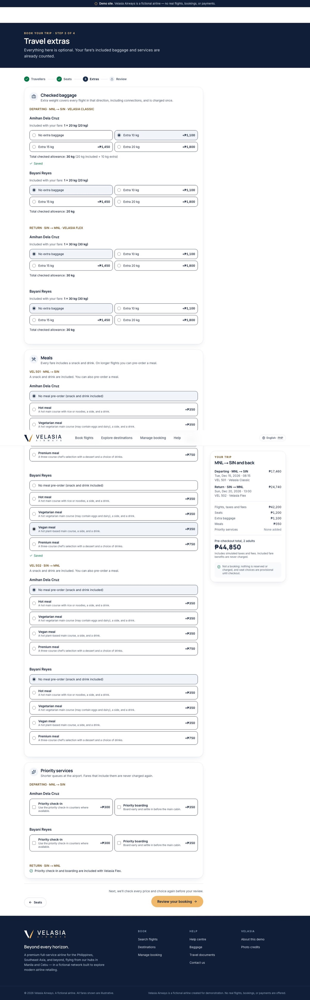
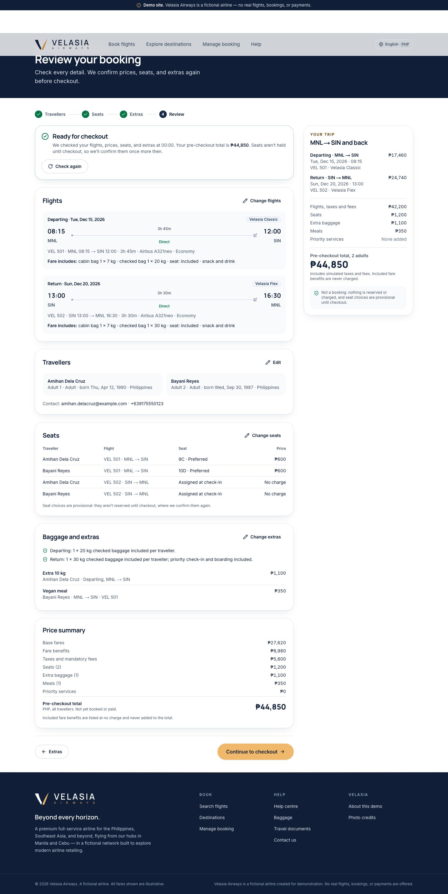
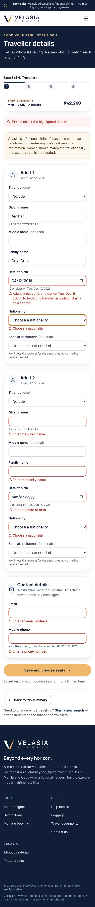
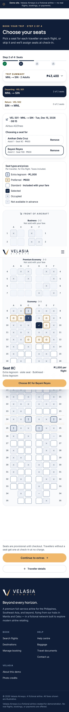
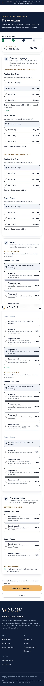
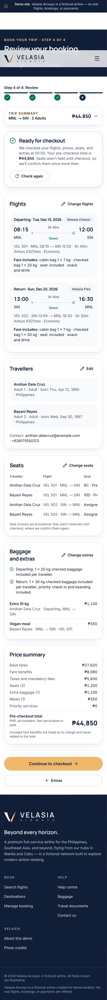

# Milestone 4 report: Passengers, seat maps & ancillary retailing

Branch `feat/m4-passengers-seats-ancillaries`, based on `main` after M3 (PR #4) was merged.
Runtime: official Next.js 16.4 on Node.js. No NextRS, no database, no TalaDB, no real airline
APIs, no orders, no payments.

M4 turns the M3 shopping session into a complete **pre-checkout booking**: traveller details,
aircraft-specific seat maps, checked baggage, meals, and priority services, then a review that
re-prices and re-checks everything and produces an itemised **pre-checkout quote**. Nothing is
booked: seat choices are provisional preferences, no inventory is held, and the "Continue to
checkout" button leads to a clearly labelled preview that creates nothing.

## Scope change

The original roadmap put orders, holds, payments, and TalaDB in M4. They now belong to M5, and
the former M5/M6 scope moved down one milestone; [ROADMAP.md](ROADMAP.md) records this. Nothing
was dropped.

## Features implemented

- **Booking steps.** `/booking/travellers` → `/booking/seats` → `/booking/extras` →
  `/booking/review` → `/booking/checkout` (preview). There's a shared frame with a progress
  indicator, the step's content, a sticky trip and price panel on desktop, and a collapsible
  summary on phones. `/booking/travelers` redirects to the British spelling used across the
  site.
- **Step gating on the server.** Each step's state (`locked | open | complete`) comes from the
  API and is enforced on every mutation. Pages render a recovery panel (no session, expired
  session, earlier step to finish, service down) with one clear way forward. Refreshes,
  back/forward, and deep links all re-render from the session.
- **Traveller details.**
  - One card per priced passenger (Adult 1, Child 1, Infant 1…). The party can't change, because
    offers are priced for it.
  - React Hook Form with the shared Zod schema, inline errors with `aria-describedby`, and
    descriptions. Saving goes through a Server Action, and the form still works without
    JavaScript.
  - Title, middle name, and special assistance (a short list, never free text) are optional.
  - Contact email and phone in E.164 form. No passport or document fields.
- **Seat maps.** Four aircraft-specific layouts, with live availability that matches the
  inventory, per-fare prices, and the eligibility rule shared with the API. The seat selector
  offers:
  - flight tabs (each segment of a connection or round trip has its own map);
  - a traveller selector that moves on to the next traveller automatically;
  - a legend, and a details panel that shows the price before you confirm;
  - change and remove;
  - one tab stop with arrow-key navigation, a full accessible name for every seat, and states
    that never rely on colour alone (icons for occupied, blocked, preferred, extra legroom,
    selected, and a companion's number).
- **Extras.**
  - Extra baggage on top of the fare's included allowance, showing the included, extra, and
    total weight.
  - Meals per flight: none on short flights, complimentary choice in Business.
  - Priority check-in and boarding, never offered to fares that include them.
  - Choices save as they change (optimistic, with a "Saved" or error status per section).
    Nothing is preselected and nothing is shown as mandatory.
- **Review.** Itinerary (times, flight numbers, aircraft, durations, connections, fare family
  and what it includes), travellers and contact, a seat table ("Assigned at check-in" when none
  is chosen), baggage and extras (included vs purchased), and an itemised price summary. A
  final check (re-price, re-check, re-quote) sets `READY` or lists issues with links to the
  right step. A higher price must be accepted on the page, and a seat taken meanwhile is
  released and the traveller sent back to choose again.

## Domain model changes

All in the M3 session (`StoredSession.booking`); there is no separate cart.

```ts
booking: {
  slots: TravellerSlot[];             // ADT1, CHD1, INF1… from the priced party
  passengers: Traveller[] | null;     // private; owner only
  contact: Contact | null;
  seats: SeatAssignment[];            // { travellerId, flightId, seatId, category, priceMinor, included }
  ancillaries: AncillarySelection[];  // { id: slot, productId, category, travellerId, direction, flightId, quantity, priceMinor, included }
  steps: { travellers, seats, extras, review }; // locked | open | complete
  notices: BookingNotice[];           // what the API changed (seat removed, now included, offer refreshed…)
  review: { status: READY | ACTION_REQUIRED, checkedAt, sessionVersion, current, totalMinor, issues } | null;
}
summary: { totalMinor /* flights + extras */, flightsTotalMinor,
           totals: { baseFareMinor, fareFamilyMinor, taxesMinor, extrasMinor },
           extras: { seatsMinor, baggageMinor, mealsMinor, priorityMinor, totalMinor }, … }
```

New contracts: `travellers.ts` (rules, slots, schemas, `travellerIssues`), `seatmaps.ts`
(seat map, categories, statuses, `seatProblem`), `ancillaries.ts` (catalogue, offers, slot
changes), `booking.ts` (booking state, steps, review, quote). New error codes:
`SESSION_CONFLICT`, `BOOKING_STEP_UNAVAILABLE`, `PASSENGERS_INVALID`, `TRAVELLER_MISSING`,
`SEAT_UNAVAILABLE`, `SEAT_INELIGIBLE`, `ANCILLARY_UNAVAILABLE`, `INVALID_QUANTITY`, and
`PRICE_CHANGED`. Session expiry, offer expiry, and upstream outages reuse the M3 codes.

## API endpoints

| Service | Endpoint                                           | Notes                                                                       |
| ------- | -------------------------------------------------- | --------------------------------------------------------------------------- |
| Fastify | `GET /v1/flights/:id/seatmap`                      | Public layout + availability; `no-store`                                    |
| Fastify | `GET /v1/ancillaries`, `GET /v1/ancillaries/:id`   | Public catalogue (descriptions, list prices by route length); cacheable     |
| Fastify | `GET /v1/shopping-sessions/:id/seatmaps/:flightId` | Bearer. Map + this fare's prices + who may sit where + this session's seats |
| Fastify | `GET /v1/shopping-sessions/:id/ancillaries`        | Bearer. What each traveller can buy, allowances, meal service per flight    |
| Fastify | `GET /v1/shopping-sessions/:id/review`             | Bearer. Itemised quote + readiness, without re-pricing                      |
| Fastify | `PUT /v1/shopping-sessions/:id/passengers`         | Bearer. Strict; all travellers + contact; optional `expectedVersion`        |
| Fastify | `PUT /v1/shopping-sessions/:id/seats`              | Bearer. Set/clear seats per traveller and flight; atomic; no price field    |
| Fastify | `PUT /v1/shopping-sessions/:id/ancillaries`        | Bearer. Slot changes (baggage, meal, priority); atomic; no price field      |
| Fastify | `POST /v1/shopping-sessions/:id/steps`             | Bearer. `{ step: seats \| extras }`: finish a step                          |
| Fastify | `POST /v1/shopping-sessions/:id/validate`          | Bearer. Re-price, re-check, re-quote, record the review                     |
| Next.js | `GET /api/flights/[id]/seatmap`                    | The guest's own view for their flights, else public; `private, no-store`    |
| Next.js | `GET /api/ancillaries`                             | Cached catalogue (`use cache`, `cacheTag('ancillaries')`)                   |

Every mutation authorises the bearer token, validates with Zod (strict bodies), checks step
prerequisites, the offers, and the traveller, seat, and product references, and applies the
change synchronously to a clone of the booking that is kept only if everything succeeds. It
returns the whole updated session with authoritative totals. Public errors never include stack
traces, hostnames, or personal details.

## Seat layouts

Fictional but plausible, and different per type; there is no row 13. Every layout is checked
against the fleet's cabin capacities at startup.

| Aircraft | Business                 | Premium Economy† | Economy                                                      | Total |
| -------- | ------------------------ | ---------------- | ------------------------------------------------------------ | ----- |
| A320neo  | —                        | 3-3, rows 1–2    | 3-3, rows 3–31, exits 11–12 (168)                            | 180   |
| A321neo  | 2-2, rows 1–3            | 3-3, rows 4–7    | 3-3, rows 8–35, exits 24–25; rows 34–35 lose A/F (158)       | 194   |
| 737-8    | 2-2, rows 1–2            | —                | 3-3, rows 3–30, exits 15–16 (162)                            | 170   |
| A330-900 | 1-2-1 lie-flat, rows 1–6 | 2-3-2, rows 7–9  | 3-3-3, rows 10–38, exit 25; rows 34–38 narrow to 2-3-2 (242) | 287   |

† No fare family sells Premium Economy yet, so those seats show as "Not sold with your fare".

Categories:

- **Extra legroom:** the first Economy row (a bulkhead) and the exit rows.
- **Preferred:** the next four rows ("front of cabin").
- **Business:** every Business seat.
- **Standard:** everything else.

The row in front of an exit row has limited recline. Exit rows are for adults travelling without
a lap infant. Lap infants get no seat.

**Availability** per flight: exactly `sold` seats per cabin are occupied (seeded and
deterministic, filled front-, window-, and aisle-first), and up to two Economy seats are held
for the airport. The holds still count as seats left, so `available + blocked` always equals the
inventory's seats left; a test checks this for every flight of a day. Cancelled flights, and
flights whose sales have closed, have no selectable seats. A guest's choice never changes
availability.

## Ancillary rules (fictional)

| Product                      | Scope                 | Eligibility                          | Short / medium / long                                                      |
| ---------------------------- | --------------------- | ------------------------------------ | -------------------------------------------------------------------------- |
| Standard seat                | traveller × flight    | Light only (Classic+ include it)     | ₱150 / ₱300 / ₱450                                                         |
| Preferred seat               | traveller × flight    | Light, Classic (Flex includes it)    | ₱350 / ₱600 / ₱850                                                         |
| Extra-legroom seat           | traveller × flight    | Economy fares                        | ₱600 / ₱1,000 / ₱1,400                                                     |
| Extra 10 / 15 / 20 kg        | traveller × direction | Adults, children                     | ₱700 / ₱1,100 / ₱1,500 · ₱950 / ₱1,450 / ₱2,000 · ₱1,200 / ₱1,800 / ₱2,500 |
| Hot, vegetarian, vegan meal  | traveller × flight    | Flights ≥ 90 min                     | ₱350                                                                       |
| Child meal                   | traveller × flight    | Children, flights ≥ 90 min           | ₱280                                                                       |
| Premium meal                 | traveller × flight    | Flights ≥ 3 h                        | ₱750                                                                       |
| Priority check-in / boarding | traveller × direction | Not with Flex or Business (included) | ₱200 / ₱300 / ₱400 · ₱250 / ₱350 / ₱450                                    |

- Business seats and Business meal choices are included (₱0).
- Included checked baggage comes from the fare family (Light 0, Classic 1 × 20 kg, Flex
  1 × 30 kg, Business 2 × 32 kg); extra weight adds to it.
- Direction-scoped products are priced by the direction's longest flight and charged once
  across a connection.
- Lap infants share their adult's services in this demo.
- Prices include any applicable taxes. Quantities other than one are refused
  (`INVALID_QUANTITY`).

## Pricing behaviour

- Integer minor units (PHP centavos) throughout, with no floating-point money.
- Seat and service prices are computed from the catalogue and the _current_ fare whenever the
  session is read. A fare change therefore re-prices them immediately, and included items always
  cost 0.
- Changing a seat replaces its charge. Choosing another bag size replaces the old one.
- `summary.totalMinor = flightsTotalMinor + extras.totalMinor`, and the base, family, taxes, and
  extras components add up to it (tested).
- The review quote is itemised: one line per direction's offer, per seat, and per service.
  `buildQuote` throws if the lines and totals ever disagree, if any amount is negative or not an
  integer, or if an included line carries a charge.
- Offer price changes follow M3: a valid offer keeps its price, an expired one is refreshed at
  the same price (with a notice), and a different price waits as `pendingOffer` until the
  traveller accepts it on the review. Seats and extras survive the acceptance.
- The total is labelled a **pre-checkout quote**, "Not yet booked or paid". M5 must validate it
  again.

Example (2 adults, MNL → SIN VEL 501, Light): flights ₱15,080, plus an extra-legroom seat
(₱1,000) and a standard seat (₱300), Extra 15 kg (₱1,450), and a vegetarian meal (₱350), gives
a pre-checkout total of ₱18,180. The E2E test asserts each component and their sum.

## Server Actions

`savePassengersAction`, `selectSeatAction`, `removeSeatAction`, `continueFromSeatsAction`,
`updateBaggageAction`, `selectMealAction`, `updatePriorityAction`, `continueFromExtrasAction`
(finish the step, then run the review check), `validateBookingReviewAction`, and
`acceptPriceChangeAction`. Each one:

- takes the session only from the HTTP-only `velasia-shopping` cookie;
- parses a small, specific Zod input (no catch-all mutation; extra fields such as prices are
  dropped);
- checks the step;
- calls the API;
- returns a typed `BookingActionState` (`saved` or `error` with a code: `invalid-input`,
  `rejected`, `seat-unavailable`, `conflict`, `step-locked`, `session-expired`, `uncertain`,
  `unavailable`);
- calls `refresh()` so the page and its totals re-render from the session.

On a timeout after a mutation the action never retries. It reports that the outcome is unknown
and re-renders from what the session holds; the `slow-commit` fault tests exactly this.

## Security review

- **Ownership.**
  - Every private route requires the session's bearer token. A wrong token returns the same
    404 as an unknown session.
  - Actions read credentials only from the HTTP-only cookie.
  - Tested: cross-session read and write are refused, a tampered cookie is refused, and an
    action without the guest's own cookie is refused.
- **No client-trusted money.**
  - Strict request bodies have no price fields; a price sent anyway is a 400 at the API and is
    dropped by actions.
  - Forged seat, traveller, flight, and product ids are rejected, before any API call where the
    format is wrong.
  - Included services can't be bought.
- **Concurrency.**
  - Synchronous, all-or-nothing updates. Stale `expectedVersion` returns `SESSION_CONFLICT`
    (the traveller form always sends it).
  - Nine concurrent extras requests all apply, with none lost.
  - Seat and extras changes are per-slot and idempotent.
  - "Continue" doesn't send a version (it changes no choice), so an in-flight seat change can't
    block it.
- **Privacy.**
  - No personal data in URLs, cookies, browser storage, or Zustand.
  - Server logs carry error codes only; a test checks that no traveller detail is printed.
  - API errors are written without personal details; a test checks they never echo names or
    emails.
  - The booking error boundary logs nothing.
  - Session data is `private, no-store` end to end, and booking pages are `noindex`.
  - The traveller form asks for made-up details, and every fixture, test, and screenshot uses
    synthetic travellers.
  - The public seat map and catalogue contain no session data; the storefront seat-map handler
    falls back to the public map for flights outside the guest's trip.
- **Inputs.** Request bodies are limited to 16 KiB, names to Latin letters, spaces, hyphens, and
  apostrophes, special assistance to a fixed list, and nationality to a fixed list.

Accepted for M4: seats are not held, so two guests can provisionally choose the same seat. Both
see "provisional", the review re-checks availability, and M5's atomic commit decides.

## Test results

Run locally on macOS (Node 22.22) on 2026-11-15 with the pinned E2E "today" of 2026-12-01.

| Command                                           | Result                                                                        |
| ------------------------------------------------- | ----------------------------------------------------------------------------- |
| `pnpm format:check`                               | Clean                                                                         |
| `pnpm lint`                                       | 4/4 packages, 0 errors, 0 warnings                                            |
| `pnpm typecheck`                                  | 4/4 packages + E2E suite, 0 errors                                            |
| `pnpm test`                                       | **416 passed**: contracts 89, retailing-api 223, web 104 (M3: 344)            |
| `pnpm build` (web)                                | Succeeds; all five booking routes are partial prerenders                      |
| `pnpm exec playwright test`                       | **72 passed**, 9 skipped (mobile-only tests in the desktop project), 0 failed |
| `playwright test booking.spec.ts --repeat-each 3` | 30 passed, 3 skipped, 0 failed                                                |

New coverage:

- **Contracts:** slots, ages (including leap-day birthdays), form schema errors on the right
  fields, trip rules, name and phone rules, and `seatProblem`.
- **API unit tests:** every layout matches the fleet; the grids differ; cabin boundaries, exit
  rows, bulkheads, preferred rows, positions, and missing seats; availability equals the
  inventory for every cabin of every flight on a day; determinism; the seat-taken swap; closed
  flights; and seat prices by fare.
- **API integration (40 tests):**
  - Travellers: step locks; valid adult, child, and infant parties; age, infant, and escort
    rules; 400s for fields; party mismatch and forged or duplicate ids; isolation; stale
    versions.
  - Seat maps: public consistency; per-fare pricing for all four families.
  - Seats: select, change, and remove with totals; several travellers; no duplicates; swaps;
    atomic failure; occupied, blocked, other-cabin, exit-row, and infant seats; forged fields;
    connections across two aircraft; two guests on one seat; expiry; reconciliation after fare
    and flight changes.
  - Extras: the catalogue; step locks; allowances; band pricing; connections charged once; meal
    eligibility and child meals; complimentary Business meals; Flex priority refused; invalid,
    duplicate, quantity, and stranger cases; now-included removal.
  - Review: quote lines add up; ready only after validation; stale after a change; round trips;
    expired offer refreshed; price change accepted with seats kept; seat taken released;
    sold-out; unfinished steps; concurrent writes; a lost answer still applied.
- **Next.js integration (13 tests):** traveller action success, field errors, forged traveller,
  stale version, and unauthorised or tampered cookies; seat prices ignore browser values; forged
  ids are rejected before any fetch; seat taken; uncertain timeout with no retry; extras with the
  review check; the seat-map Route Handler (own, public, other flight, 400); catalogue caching;
  no PII in logs.
- **E2E (`booking.spec.ts`):** the 27 scenarios from the brief:
  - search → offer → travellers;
  - required-field and age validation;
  - two travellers;
  - the seat map: occupied seats refused, both seats chosen, one changed, prices updating;
  - baggage, meal, and priority added (priority then removed);
  - the review with a reconciled breakdown;
  - back to edit, then a refresh restores everything;
  - expired offer and price increase;
  - seat taken meanwhile and API timeout;
  - keyboard-only seat selection;
  - mobile form and seats with no page overflow;
  - axe on travellers, seats, extras, review, and mobile;
  - no hydration errors;
  - no order, payment, or ticket request;
  - deep links without a session, and locked steps.

  M3's E2E checks of the old placeholder page now check the real traveller step and its total.

**Fixed during verification:**

- Product ids with digits were rejected by the extras action.
- The `slow-commit` fault returned at once, because a request with a body emits `close` once
  it has been read; it now listens on the socket.
- A seat taken meanwhile locked the review instead of explaining it; a step already finished now
  stays reachable.
- A companion's seat failed axe's label-in-name rule.
- A quick "Continue" after an optimistic seat removal raised a version conflict.
- The seat selector's pending state could stick under load (now `useTransition`).
- Some E2E locators matched hidden copies of earlier steps, which Next 16 keeps mounted; the
  tests now use visible-only locators.

## Screenshots

From the production build, pinned date, synthetic travellers (`docs/screenshots/`):

| Traveller details with validation                                          | Seat selection, round trip (A321neo)                    |
| -------------------------------------------------------------------------- | ------------------------------------------------------- |
|        |          |
| **Travel extras**                                                          | **Booking review, ready for checkout**                  |
|                           |        |
| **Mobile travellers**                                                      | **Mobile seats (sticky seat panel)**                    |
|  |    |
| **Mobile extras**                                                          | **Mobile review**                                       |
|                     |  |

## Known limitations

- **No holds.** Seats are provisional; two guests can choose the same seat, and only the review
  re-check (and M5's commit) resolves it.
- **One API process, in memory.** A restart loses sessions, including traveller details. Several
  instances wouldn't share them.
- **Scenario limits.** The `seat-taken` scenario marks the session's _current_ seats as taken;
  once released, the seat shows as available again. It is a test device, not a model of other
  guests.
- **Prices are read live.** Ancillary and seat prices are computed when read rather than stored
  at selection. They are deterministic catalogue prices, so they can't drift within a session,
  but a catalogue change would apply to existing sessions (the quote records `priceVersion`).
- **Simplified rules.** Lap infants have no baggage or meals of their own; there are no
  bassinets, no paid infant seats, and no Premium Economy fare family. Exit-row and age rules
  are simplified and fictional, and no travel documents are collected or verified.
- **Single-day review.** The review checks availability once. With a pinned clock, price holds
  never end naturally; the scenarios simulate time passing.
- **Next 16 hidden routes.** Previously visited routes stay mounted but hidden (React Activity),
  so the hidden pages hold the guest's own data in memory until the tab closes. They are never
  persisted.

## Recommended M5 scope

1. Create an **order** from a `READY`, current review (`sessionVersion` must match), re-pricing
   and re-checking once more inside one atomic TalaDB transaction.
2. **Hold** seats and decrement inventory at order creation, the first durable inventory change;
   on conflict, return `SEAT_UNAVAILABLE` and send the traveller back to seats with their other
   choices kept.
3. **Idempotent checkout:** an idempotency key per checkout attempt, safe retry after a timeout
   (reconcile by key; never double-charge), and a simulated payment with clear states.
4. Store each order's item prices at commit, including seats and ancillaries (so far they are
   computed live); keep `priceVersion` for audit.
5. Move sessions and orders to TalaDB, so several API instances can share them, and drop the
   one-session-per-browser limit.
6. Replace the checkout preview with the real checkout step, keeping "pre-checkout quote" and
   "paid" clearly distinct.
