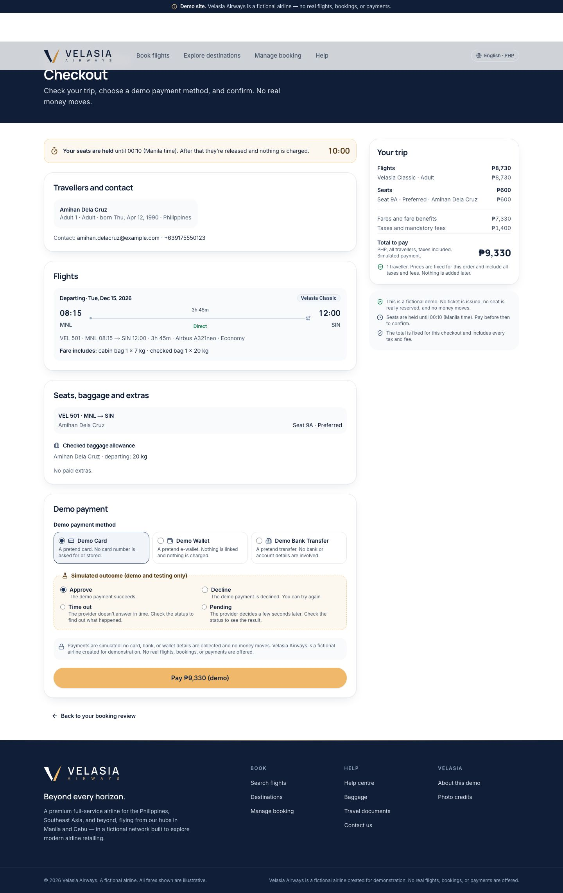
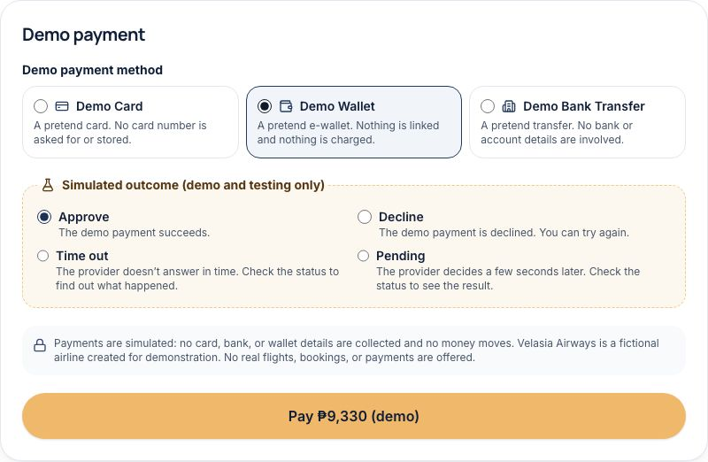
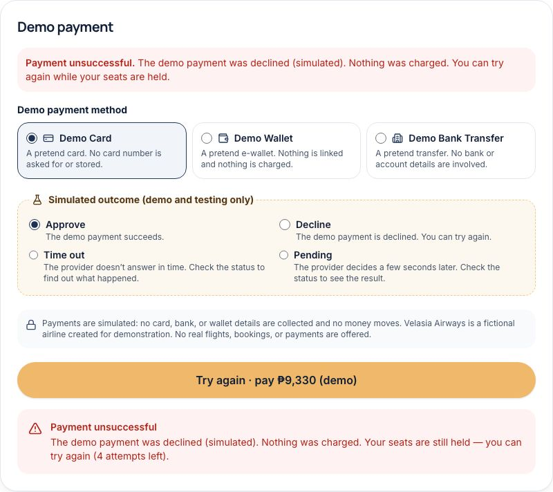
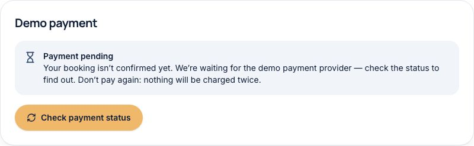
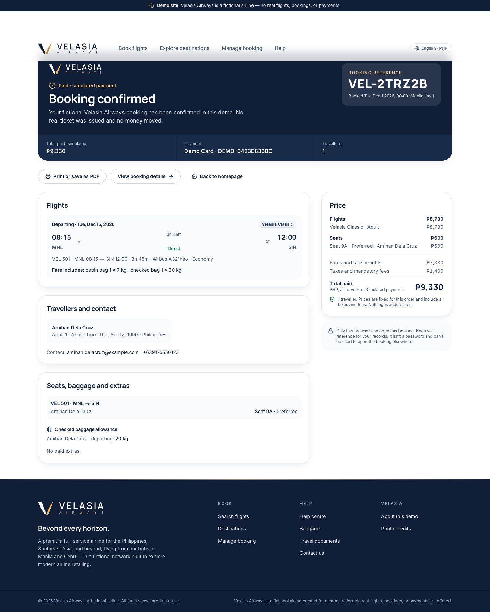
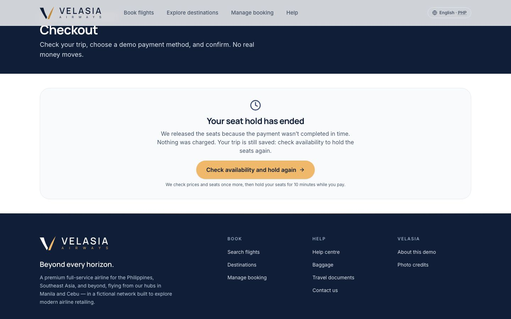
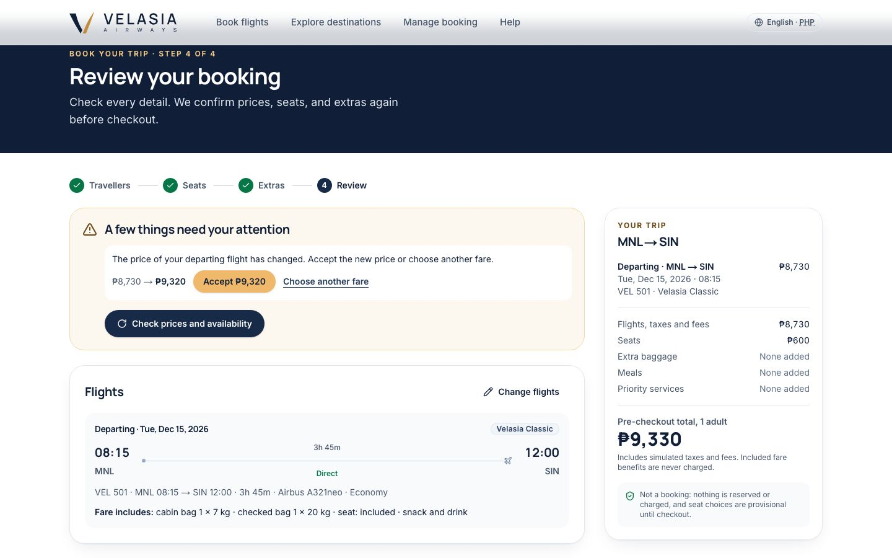

# Milestone 5 report: Checkout, durable orders, TalaDB & simulated payments

Branch `feat/m5-checkout-taladb-orders`, based on `main` after M4 (PR #5) was merged.
Runtime: official Next.js 16.4 on Node.js 22. No NextRS, no real payment gateway, no real
airline systems. TalaDB is the only database, and only the retailing API touches it.

M5 turns the M4 pre-checkout quote into a **durable order**. Checkout re-validates the booking,
creates a pending order that holds its seats, takes a simulated payment, and confirms the order
only when the payment succeeded and the hold was committed in the same durable write. Orders
survive refreshes, new tabs, and restarts of the retailing API, and only the browser that made
them can open them.

## Prerequisites checked

- M4 is merged into `main` (PR #5, `53178f6`), with the M3 and M4 reports, contracts, and tests
  in place. No unmerged branch was needed.
- The M4 limitations that mattered for orders: seats were provisional (never held), shopping
  sessions and offers live in one process's memory, prices of seats and extras are computed
  when read, and the "Continue to checkout" button led to a preview that created nothing.
  M5 addresses the first and last; sessions stay in memory (see
  [Known limitations](#known-limitations)).

## Features implemented

- **Checkout** (`/booking/checkout`, `/checkout` redirects there). "Continue to checkout" on the
  review re-validates everything once more and creates the pending order with a 10-minute seat
  hold. The page renders the order — not the shopping session — so it shows exactly what is
  being bought:
  - a hold timer counting down from the server's own time;
  - travellers and contact, flights, seats, baggage allowances, and extras;
  - a demo payment section: Demo Card, Demo Wallet, Demo Bank Transfer;
  - a fenced, clearly labelled "simulated outcome (demo and testing only)" control;
  - the demo disclaimer, and a pay button that states the total (`Pay ₱9,330 (demo)`);
  - a sticky itemised summary with taxes and the total in PHP, plus the conditions.

  On phones the trip summary folds away above the form, with the total always visible and a
  "Go to payment" link.

- **Payment outcomes.** Approve → confirmation. Decline → "Payment unsuccessful", the seats stay
  held, and the traveller can retry (up to 5 attempts). Pending → "Payment pending" and a
  status check. Time out → the result is unknown: the page replaces the pay button with
  "Confirming your payment… don't pay again" and a status check. Never a blind retry.
- **Recovery panels.** A hold that ended ("check availability and hold again"), a checkout
  whose payments all failed, a replaced checkout, and no checkout at all. Each has one clear
  way forward.
- **Price changes.** A different total blocks checkout: the review explains the change and
  asks for acceptance (M4's accept flow), and the new total is what the order uses. A total is
  never raised silently.
- **Confirmation** (`/booking/confirmation/[orderId]`). It shows:
  - the Velasia logo, "Booking confirmed", the booking reference, and when it was booked;
  - the total paid (simulated), the demo method with its provider reference, and the travellers;
  - flights, fares, seats, baggage allowances, and extras;
  - an itemised price.

  It offers print / save as PDF (browser print with a print stylesheet), "View booking details",
  and "Back to homepage". It says "Your fictional Velasia Airways booking has been confirmed in
  this demo". Only a confirmed order is called a booking; pending and failed orders show
  "Payment pending" or "Payment unsuccessful" instead.

## Persistence: TalaDB

| Item          | Detail                                                                                                                                                                                                                                                                                                                                |
| ------------- | ------------------------------------------------------------------------------------------------------------------------------------------------------------------------------------------------------------------------------------------------------------------------------------------------------------------------------------- |
| Packages      | `taladb@0.13.0` (client, `openDB({ migrations })`) and `@taladb/node@0.13.0` (napi-rs binding over redb), exact pins in the pnpm catalog, installed in `apps/retailing-api` only                                                                                                                                                      |
| Binaries      | Published for `darwin-arm64`, `linux-x64-gnu`, `win32-x64-msvc`. **Not for `darwin-x64`** (every release up to 0.13.0, although `napi.triples` lists it). CI (Ubuntu) is unaffected. This milestone was developed on an Intel Mac by building the binding from the `v0.13.0` tag (`cargo build --release -p taladb-node`, ~4 minutes) |
| File          | `TALADB_PATH` (default `apps/retailing-api/data/velasia.db`, gitignored). The parent directory is created at startup                                                                                                                                                                                                                  |
| Lifecycle     | Opened once in a Fastify plugin before the app reports ready, migrated and index-verified, health-checked (`GET /health/ready`), drained and closed on shutdown. Tests and builds use temporary files                                                                                                                                 |
| Single writer | TalaDB locks the file: a second process (or a second open in the same process) is refused, and the API exits with "in use by another process"                                                                                                                                                                                         |
| Reset         | `pnpm --filter @velasia/retailing-api db:reset` (dry run) / `--confirm`; refuses while an API holds the file. Nothing is ever reset automatically                                                                                                                                                                                     |

### What was verified about TalaDB (by probe and by tests)

| Capability                                    | Result                                                                                                                                                                                                                          |
| --------------------------------------------- | ------------------------------------------------------------------------------------------------------------------------------------------------------------------------------------------------------------------------------- |
| Multi-document / multi-collection transaction | **None** in the Node binding or the client. One `insert`, `insertMany`, or `updateOne` is one redb write transaction                                                                                                            |
| Single-document atomicity                     | Yes. `updateOne` re-evaluates its filter inside the exclusive write transaction, so `{ orderId, rev: n }` is a real compare-and-set: 20 concurrent writers from the same revision → exactly 1 succeeds (also a repository test) |
| Unique indexes                                | **None**. Uniqueness (booking references, idempotency keys) is enforced by the serialized writer, checked before each insert                                                                                                    |
| Concurrency of the client                     | The `taladb` client's Node path uses the async binding (`insertAsync`, `updateOneAsync` on the libuv pool), so read-then-write sequences across `await`s _can_ interleave. Hence the serial writer below                        |
| Durability                                    | Immediate durability (fsync per commit): every committed write survived `SIGKILL` (tested). Each write costs ~20 ms on this Mac, so writes are serialized at roughly 40–50 per second                                           |
| Migrations                                    | `openDB({ migrations })` stores the version and runs each once; `createIndex` is idempotent, so a migration interrupted part-way is safe to re-run                                                                              |
| Indexes, queries                              | B-tree indexes on top-level fields; equality, `$in`, ranges, and array containment (`flightIds: 'NV501-…'`) used. A dot-path `$set` (`'a.b'`) writes a literal `"a.b"` key, so whole top-level fields are replaced instead      |
| Closing                                       | `db.close()` releases the file lock **only once every collection handle has been garbage-collected**. An in-process reopen fails until then; the tests force a GC or restart real processes. Worth fixing in TalaDB             |

## Checkout consistency design

TalaDB can't commit several documents together, so M5 doesn't pretend it can. The design is a
**constrained single writer**:

1. **One document per order.** The order, its items, its seat hold and allocations, its
   payment attempts, and its event history are one TalaDB document (`orders`). Every state
   change of an order is one compare-and-set write of that document, so the order and its hold
   can never disagree.
2. **One writer.** Every operation that reads inventory or an order and then writes runs
   through `SerialQueue`, in arrival order. A caller can time out, but the queue still waits
   for the task to settle before starting the next. Together with TalaDB's file lock, nothing
   else can write.
3. **Inventory derived from durable state.** No seat counters are stored. `AllocationLedger`
   is an in-memory index of the holds in `orders`: rebuilt at startup and updated only after a
   successful write. `seatsAvailable` (search, offers, eligibility) and the seat maps subtract
   it from the seeded demand. A hold takes seats while it is `COMMITTED`, or `HELD` and
   unexpired, or `HELD` with an undecided payment ("pinned"). Expiry is evaluated on every
   lookup, so an ended hold frees its seats immediately, before any sweep.
4. **All-or-nothing trips.** A round trip or connection is one order with one allocation per
   flight, written in one insert: it holds every flight or none.
5. **A guest never competes with themselves.** Session-scoped operations (review, seat map,
   re-validation) ignore that session's own _pending_ hold, so going back to the review or
   checking out the same trip again doesn't make their own seat look taken. Confirmed orders
   always count.

### Inventory commitment protocol (`POST /v1/checkout/prepare`, inside the queue)

1. Authorise the shopping session (bearer) and read the guest token (`x-velasia-guest`).
2. **Idempotency.** The same key with the same parameters returns the existing order (`200`,
   `replayed: true`). The same key with other parameters, or for another guest, is refused
   (`409 IDEMPOTENCY_CONFLICT`).
3. A session already booked is refused (`SESSION_ORDERED`). The same request from another tab
   (another key) returns the session's pending order.
4. The session version must equal `expectedVersion` (what the traveller reviewed).
5. Final validation (M4's): re-price the offers, re-check travellers, seats against current
   availability (other orders' holds included), and services; rebuild the quote. A changed
   price is `CHECKOUT_NOT_READY` (accept it on the review); a total that differs from
   `acceptedTotalMinor` is `PRICE_CHANGED`.
6. Build the immutable snapshot and items. If the session has a pending order for the same
   trip, return it. If the trip changed, cancel the old order (release its seats) unless a
   payment is undecided.
7. Check every flight's count and every chosen seat against all active holds.
8. Generate a unique reference, then write the order with its `HELD` hold: one insert. Then
   update the ledger.

### Payment protocol (`POST /v1/orders/:id/payment-attempts`)

- **A (queue):** ownership and idempotency checks, then lazy expiry. Refuse a confirmed
  (`ORDER_ALREADY_CONFIRMED`, nothing charged), expired (`410 HOLD_EXPIRED`), failed, or busy
  (`PAYMENT_IN_PROGRESS`) order. Record the attempt as `PROCESSING` (durable before anything
  is charged). The hold is now pinned.
- **B (outside the queue):** call the simulated provider, which records its own charge
  durably in `payment_provider` before answering. It is idempotent per attempt.
- **C (queue):** apply the answer in one write.
  - `SUCCEEDED`: attempt succeeded, hold `COMMITTED`, order `CONFIRMED`.
  - `DECLINED`: attempt failed; after the last allowed attempt the order is `PAYMENT_FAILED`
    and its seats are released.
  - `PENDING`, or no answer in time: attempt `PENDING` or `UNKNOWN`.

The amount is always the order's own total; the request has no amount field.

### Recovery (`reconcile`: at startup, every `ORDER_SWEEP_INTERVAL_MS`, and on status checks)

For every pending order, and every held order past its expiry:

- An undecided attempt is looked up at the provider.
  - A record exists: apply it (confirm, fail, or stay pending; a due `PENDING` charge is
    decided first).
  - No record, and nothing in this process is still talking to the provider: the charge never
    happened, so the attempt fails with "nothing was charged" and the traveller can pay again.
  - Never invents a success.
- Then expire the hold if it ended and nothing is undecided.

All of it is idempotent: running it twice changes nothing (tested).

### Guarantees and their limits

| Guarantee                          | Holds because                                                                                                   | Limit                                                                                                                       |
| ---------------------------------- | --------------------------------------------------------------------------------------------------------------- | --------------------------------------------------------------------------------------------------------------------------- |
| No duplicate orders from retries   | Durable idempotency key + request hash per session; same trip ⇒ same pending order                              | Within one shopping session. Two different sessions can book the same trip twice (by design: two bookings)                  |
| No oversold seat or duplicate seat | Serialized check-and-write against holds derived from durable orders; one insert per order                      | **One API process per database file.** Seeded "other customers" demand is simulated and can grow overnight (see below)      |
| No false confirmation              | `CONFIRMED` only in the same write that commits the hold, from a provider record of success for the order total | The provider is simulated; its record is the only source of truth                                                           |
| Server-authoritative prices        | Strict bodies with no price fields; the agreed total is only compared; items are snapshotted and must sum to it | —                                                                                                                           |
| Durable orders after restart       | Immediate durability; the ledger is rebuilt from `orders`; startup reconciliation                               | Shopping sessions are in memory: after a restart a _pending_ order can still be paid, but a new checkout needs a new search |
| Safe recovery                      | Every cross-document gap (order ↔ provider) is closed by asking the provider; every other change is one write   | —                                                                                                                           |
| Private orders                     | Guest token (hash stored), checked by the API on every read and write; same 404 for unknown and not-yours       | Losing the cookie loses access (no accounts until M6)                                                                       |

## Order model

`orders` (schema version 1, `src/db/schema.ts`), one document per order:

- **Identity:** `orderId` (`ord_` + 128 random bits), `reference` (`VEL-XXXXXX`), `rev` (CAS).
- **Ownership:** `guestId`, `ownerTokenHash` (SHA-256 of the guest token).
- **Checkout:** `sessionId`, `checkoutKey`, `checkoutRequestHash`, `contentHash`.
- **State:** `status`, `createdAt`, `updatedAt`, `confirmedAt`.
- **Money:** `currency`, `totalMinor`, `totals`, `pricingVersion`.
- **`snapshot`:** search, journeys (offer id, fare family, cabin, the itinerary as sold,
  services, offer price), passengers, contact, seats, ancillaries, and baggage allowances.
- **`items`:** one per product, with kind, label, detail, direction, traveller, flight, product
  code, quantity, unit price, amount, and whether it is included.
- **`hold`:** `holdId`, status, created / expires / committed / released times, release
  reason, inventory version, and `allocations[]` (flight, cabin, seats, chosen seat ids).
- **`attempts[]`:** id, idempotency key, request hash, method, simulated outcome, amount,
  status, times, failure reason, provider reference. At most 5.
- **`events[]`:** append-only, with a sequence number, type, time, and a detail without
  personal data. At most 60.
- **Index mirrors:** `paymentStatus`, `holdState`, `holdExpiresAt`, `flightIds`,
  `attemptIds`.

Indexes: `orderId`, `reference`, `guestId`, `sessionId`, `checkoutKey`, `status`,
`createdAt`, `holdState`, `holdExpiresAt`, `flightIds`, `attemptIds`; and on
`payment_provider`: `attemptId`, `orderId`. Documents are validated with Zod on every write and
read.

**Booking references** use `VEL-` plus six characters from a 31-letter alphabet without
look-alikes (about 887 million values), drawn with a CSPRNG. Each is checked against the
database before the insert and retried on a collision (tested with a forced collision). A
reference is never a credential.

## Order lifecycle

| From              | To               | When                                           | Hold               |
| ----------------- | ---------------- | ---------------------------------------------- | ------------------ |
| `PENDING_PAYMENT` | `CONFIRMED`      | a payment succeeded                            | `HELD → COMMITTED` |
| `PENDING_PAYMENT` | `PAYMENT_FAILED` | the last allowed attempt failed                | `HELD → RELEASED`  |
| `PENDING_PAYMENT` | `EXPIRED`        | the hold ended and no payment is undecided     | `HELD → EXPIRED`   |
| `PENDING_PAYMENT` | `CANCELLED`      | a newer checkout of a changed trip replaced it | `HELD → RELEASED`  |
| `CONFIRMED`       | `CONFIRMED`      | the same payment confirmed again: **no-op**    | —                  |
| anything else     | —                | refused (`InvalidTransitionError`)             | —                  |

Payment attempts: `PROCESSING → PENDING | UNKNOWN | SUCCEEDED | FAILED`,
`UNKNOWN → PENDING | SUCCEEDED | FAILED`, `PENDING → SUCCEEDED | FAILED`. All transitions live
in `orders/lifecycle.ts`, and `assertOrderInvariants` runs before every write. Among the
invariants:

- `CONFIRMED` ⇔ hold `COMMITTED` ⇔ exactly one succeeded attempt;
- at most one undecided attempt;
- every attempt is for the order total;
- items add up to the total; included items cost 0;
- events form an unbroken sequence.

## API endpoints

| Endpoint                                    | Auth                               | Notes                                                                                                       |
| ------------------------------------------- | ---------------------------------- | ----------------------------------------------------------------------------------------------------------- |
| `POST /v1/checkout/validate`                | session bearer                     | Final validation plus inventory check; reports a price change against `acceptedTotalMinor`; creates nothing |
| `POST /v1/checkout/prepare`                 | session bearer + `x-velasia-guest` | `{ sessionId, idempotencyKey, expectedVersion, acceptedTotalMinor }`. `201` new, `200` replayed             |
| `GET /v1/orders/:orderId`                   | guest bearer                       | The order (expires it first if due)                                                                         |
| `GET /v1/orders/reference/:reference`       | guest bearer                       | The reference alone grants nothing                                                                          |
| `POST /v1/orders/:orderId/payment-attempts` | guest bearer                       | `{ idempotencyKey, method, simulatedOutcome? }`. `201` new, `200` replayed, `202` undecided                 |
| `GET /v1/orders/:orderId/payment-status`    | guest bearer                       | Asks the provider about an undecided attempt and applies it. `200`, or `202` while undecided                |
| `GET /v1/payments/options`                  | public                             | Demo methods, whether outcomes can be chosen, max attempts, disclaimer                                      |
| `GET /health/ready`                         | public                             | Database health and checkout queue depth (no file path)                                                     |

Every order response is `private, no-store`. A wrong guest gets the same `404 ORDER_NOT_FOUND`
as an unknown order. New error codes: `CHECKOUT_NOT_READY`, `INVENTORY_UNAVAILABLE`,
`IDEMPOTENCY_CONFLICT`, `ORDER_NOT_FOUND`, `HOLD_EXPIRED`, `ORDER_NOT_PAYABLE`,
`ORDER_ALREADY_CONFIRMED`, `PAYMENT_IN_PROGRESS`, `SESSION_ORDERED`. A new test scenario:
`hold-expired`.

## Payment simulation

A fictional provider (`orders/payment-simulator.ts`) with its own durable ledger, treated
exactly like an external system:

- **Approve** (`SUCCESS`): succeeds at once.
- **Decline** (`DECLINED`): declined at once; nothing is charged.
- **Pending** (`PENDING`): accepted, then approved `PAYMENT_PENDING_RESOLVE_MS` later on the
  provider's own wall clock.
- **Time out** (`TIMEOUT`): **the charge succeeds but the answer is lost**. A blind retry would
  charge twice, so the API marks the attempt `UNKNOWN`, refuses new attempts, and the status
  lookup recovers the success.

Outcome controls are on in development and tests and off when `NODE_ENV=production` (then
every demo payment is approved and choosing an outcome is a `400`), and can be set with
`PAYMENT_OUTCOME_CONTROLS`. A chosen outcome only tells the simulator what to do: the backend
records and applies the provider's answer, so a client can't declare a payment successful. No
card, bank, or wallet details exist anywhere.

## Next.js

- **Server Actions** (`features/checkout/actions.ts`): `prepareCheckoutAction`,
  `validateCheckoutAction`, `submitDemoPaymentAction`, `retryPaymentAction`,
  `refreshPaymentStatusAction`. Each one:
  - parses a small Zod input;
  - reads the shopping session and guest token only from HTTP-only cookies;
  - accepts an order id only if it is this browser's current checkout (the `velasia-checkout`
    cookie), and the API checks ownership again;
  - sends an idempotency key;
  - maps API errors to typed, PII-free results;
  - never retries an uncertain request, and redirects to the confirmation only when the API
    says `CONFIRMED`.
- **Idempotency keys** come with each server render (`randomUUID()` after `connection()`). A
  double click resends the same key, and the `refresh()` after a decline or a price change
  brings a new one. The API's own guards (same request ⇒ same pending order; no new attempt
  while one is undecided) cover the rest.
- **Cookies.**
  - `velasia-guest`: the guest's 256-bit secret; HTTP-only, `SameSite=Lax`, `Secure` on https,
    30 days. It is set **before** the prepare call, so an answer lost on the way back can't
    leave an order without its owner's cookie.
  - `velasia-checkout`: the current order id; not a credential.
- **Rendering.** Checkout and confirmation are partial prerenders: a static header shell plus a
  `<Suspense>` section that reads the order with `no-store` after `connection()`. The document
  is served with `no-store` (asserted in E2E). Client components are leaves: the
  start form, payment form, status check, hold timer, and print button. TalaDB is never
  imported by the storefront.
- The confirmation route has a request-time param, so under Cache Components the header's
  `usePathname()` suspends during prerendering. `NavLink` now renders a plain link as its
  Suspense fallback (Next 16.4 docs, `use-pathname.md`).

## Security review

- **Ownership.**
  - Orders need the guest token (only its hash is stored, compared in constant time).
  - Unknown, someone else's, and missing token all get the same 404.
  - The booking reference, the order id, and the shopping session token are not order
    credentials.
  - Tested in the API (cross-guest reads, payments, and reference lookups) and in actions
    (another browser's cookies, an order that isn't the current checkout).
  - E2E: a second browser context can't open the confirmation or the checkout.
- **No client-authoritative money.**
  - Strict bodies: `amountMinor`, `status`, `totalMinor`, and `cardNumber` are `400`s.
  - The agreed total is compared, never charged.
  - Items are snapshotted and must sum to the total.
- **Test controls can't bypass the backend.** Outcome choice is off in production, and when on
  it only steers the simulator. Crash points need both `RETAILING_API_FAULTS=enabled` and
  `RETAILING_API_CRASH_TESTS=enabled`, and are off by default.
- **Privacy.**
  - No personal data in URLs, query strings, logs, or error messages (tested in API and
    action logs).
  - Order responses are `private, no-store`; pages are `noindex`.
  - Order events carry no personal data.
  - The database file lives outside the web root (the storefront never serves it) and is
    gitignored.
  - `/health/ready` doesn't reveal the path.
  - Fixtures, tests, and screenshots use synthetic travellers only.
- **No real payments.** No card, bank, or wallet field exists (asserted in E2E). Every request
  in the E2E journey stays on `127.0.0.1` (asserted).
- **Data retention (demo).** Orders are kept in the TalaDB file until it is reset
  (`db:reset --confirm`). No automatic purge in M5. The guest cookie expires after 30 days,
  after which this browser can no longer open its orders. Nothing is sent to any third party.

## Restart and fault-injection results

`test/crash-recovery.test.ts` runs the API as a child process on its own TalaDB file, kills it
with `SIGKILL` at a boundary, restarts it on the same file, and checks the durable state
directly:

- no order lost or invented;
- confirmed ⇔ committed ⇔ exactly one provider success;
- at most one charge per attempt.

| Boundary (brief)                      | Crash point / method                              | Result after restart                                                                                                                                                                                                        |
| ------------------------------------- | ------------------------------------------------- | --------------------------------------------------------------------------------------------------------------------------------------------------------------------------------------------------------------------------- |
| 1. Before durable order creation      | `prepare:before-insert`                           | No order; the seat is free                                                                                                                                                                                                  |
| 2. After pending order creation       | `prepare:after-insert`                            | Order `PENDING_PAYMENT` with its `HELD` hold; the seat is held again (ledger rebuilt)                                                                                                                                       |
| 3. During inventory allocation        | same write as 2 (order + hold = one insert)       | Either both exist or neither (1 and 2)                                                                                                                                                                                      |
| 4. Before payment result persistence  | `payment:after-attempt`, `payment:after-provider` | No provider record ⇒ attempt `FAILED`, "nothing was charged", payable again. Provider succeeded ⇒ order `CONFIRMED` by recovery; a retry with the same key replays it; still 1 charge. Provider declined ⇒ attempt `FAILED` |
| 5. After successful payment result    | `payment:after-confirm`                           | `CONFIRMED`; recovery changes nothing (same revision); 1 charge                                                                                                                                                             |
| 6. Before confirmation response       | `payment:after-confirm` (response never sent)     | as 5                                                                                                                                                                                                                        |
| 7. After confirmation, before browser | `slow-commit` fault (API + E2E)                   | The order is already confirmed when read; the storefront redirects to the confirmation                                                                                                                                      |
| Uncertain result, then restart        | `TIMEOUT` then `SIGKILL`                          | Recovery asks the provider and confirms                                                                                                                                                                                     |
| Graceful stop / restart               | `SIGTERM`, restart                                | The confirmed order, by id and by reference, identical; still private; its seat still taken                                                                                                                                 |
| Holds that ended while down           | restart a day later                               | Released (`EXPIRED`) at startup                                                                                                                                                                                             |

**Negative control:** with startup reconciliation disabled, 5 of these 9 tests fail. They test
the recovery, not the setup.

## Test results

Run locally on macOS (Intel, Node 22.22.2) on 2026-11-15, with the pinned E2E "today" of
2026-12-01.

| Command                                     | Result                                                                                                                                                                                                                                                        |
| ------------------------------------------- | ------------------------------------------------------------------------------------------------------------------------------------------------------------------------------------------------------------------------------------------------------------- |
| `pnpm format:check`                         | Clean                                                                                                                                                                                                                                                         |
| `pnpm lint`                                 | 4/4 packages, 0 errors, 0 warnings                                                                                                                                                                                                                            |
| `pnpm typecheck`                            | 4/4 packages + E2E suite, 0 errors                                                                                                                                                                                                                            |
| `pnpm test`                                 | **501 passed**: contracts 89, retailing-api 295, web 117 (M4: 416)                                                                                                                                                                                            |
| `pnpm build` (web)                          | Succeeds; checkout and confirmation are partial prerenders                                                                                                                                                                                                    |
| `pnpm exec playwright test`                 | **85 passed**, 10 skipped (mobile-only tests in the desktop project), 0 failed                                                                                                                                                                                |
| E2E stability (5 full runs while finishing) | 3 fully green. 2 runs had Server Action round trips past their wait under load (the M4 journey's checkout step; an M3 offers step; the M4 mobile test's 30 s budget). Each passed when repeated (3×); waits aligned to 20 s / 60 s. No seat or data conflicts |

New API suites:

- `taladb` (8): initialisation, indexes, reopen and migrations, the cross-process lock, SIGKILL
  durability, schema validation, compare-and-set races, the provider ledger, and references.
- `orders-lifecycle` (13): transition tables, invalid transitions, decline limits, pinned
  holds, invariants, the public view hiding internals, constant-time ownership, the ledger, and
  the serial queue (ordering, bounds, and no overlap after a timeout).
- `checkout-api` (24): order creation; round trips, lap infants, and two adults; validate; and
  stale totals.
  - Refusals: price increase then accept, an expired offer refreshed, seat taken, sold out,
    unfinished steps, stale version, price fields, missing guest token, and someone else's
    session.
  - Idempotency (same key, 6 concurrent duplicates, another tab, same trip again, changed trip
    replaces), immutability, privacy, internal fields, options, readiness, and a forced reference collision.
- `inventory-concurrency` (6): 10 concurrent checkouts for the last Business seat → exactly one
  durable holder; two guests on one seat; a connecting and a direct trip racing for a shared
  scarce flight (all-or-nothing); hold expiry (free before any sweep, durable on read,
  idempotent sweep, unpayable after); the sweep; commitment. The live ledger is compared with
  one rebuilt from the database after each.
- `payments-api` (12): every outcome, 6 concurrent duplicates → 1 charge, a reused key, paying
  a confirmed order, the attempt limit, client-supplied amount, status, and card fields, an
  expired hold, and controls disabled. After the suite, every confirmed order is checked
  against the provider ledger.
- `crash-recovery` (9): the table above.

Web (`checkout.test.ts`, 13): Server Actions against a real API.

- Cookies, double submissions, and a tampered total.
- Missing or forged session cookies.
- Validate holds nothing.
- Success, decline then retry, timeout (uncertain, retry refused, recovered by status), and
  pending.
- A double click charges once.
- Another browser's cookies and orders that aren't the current checkout.
- Unknown methods and outcomes rejected before any fetch.
- Logs carry no ids, tokens, or personal details.

E2E (`checkout.spec.ts`, 13 + 1 mobile): the 28 brief items.

- Search → fare → traveller → seat → extra baggage → meal → review → checkout. The total is
  checked, there are no card fields, and axe passes.
- Demo Wallet approve → confirmation; refresh; the document is `no-store`; print view.
- Decline → retry. Timeout → status check. Pending → status check.
- Double submission (two clicks before React re-renders) → 1 attempt.
- Lost answer → confirmation. Expired hold → hold again → pay. Expired offer at the same price.
- Price increase → accept → new total.
- A second browser can't open the booking.
- Keyboard-only payment.
- `/checkout` redirect.
- Mobile checkout and confirmation without overflow, with axe.
- No hydration errors; every request on `127.0.0.1`.

**Found and fixed during verification:**

- Going back to the review after starting checkout made the guest's own held seat look taken.
  Fixed by excluding the session's own pending hold from its own view.
- A status check skipped a timed-out charge whose provider call was still "in flight". The
  provider's record now takes precedence, and "no record" means "never charged" only once
  nothing can still create one.
- The serial queue's timeout originally let the next task start while the timed-out one might
  still write. Now only the caller stops waiting.
- Adding the confirmation route broke the build: under Cache Components, `usePathname()`
  suspends on a route with a request-time param (`NavLink` fix).
- Parallel E2E tests picked the same "6th free seat". Seats are now really held, so they
  collided. Each parallel worker now has its own band of seats.
- A stale M4 retailing API, left running from a deleted worktree, answered on the old E2E
  port. M5's runs use ports 3280/4280.

## Screenshots

From the production build, pinned date, synthetic traveller (`docs/screenshots/`):

| Checkout (desktop)                                               | Trip summary                                                |
| ---------------------------------------------------------------- | ----------------------------------------------------------- |
|                     |       |
| **Demo payment selection**                                       | **Payment unsuccessful**                                    |
|  |         |
| **Payment pending**                                              | **Confirmation (desktop)**                                  |
|              |        |
| **Expired hold recovery**                                        | **Price change warning**                                    |
|            |     |
| **Checkout (mobile)**                                            | **Confirmation (mobile)**                                   |
|               |  |

## Known limitations

- **Single writer, single process.** One retailing API process owns the database file (TalaDB
  enforces it). Several instances can't share orders or inventory; that needs a server
  database or a dedicated inventory service (M7). Writes are serialized: about 20 ms each on
  this machine, roughly 40–50 order writes per second.
- **Shopping sessions are still in memory.** A restart keeps every order, but loses sessions.
  A pending order can still be paid after a restart; a new checkout needs a new search.
- **Seeded demand is a simulation.** The "other customers" model grows as departure nears and
  is recomputed each day. Real orders always keep their chosen seats, but the simulated count
  can, in principle, exceed the remaining capacity on a later day (shown as sold out, never
  negative).
- **Pinned clock.** With `VELASIA_TODAY` set, "now" is fixed, so holds never expire on their
  own; tests use the `hold-expired` scenario or a test clock.
- **Hold timer.** It counts down from the server's reckoning at render time; after a long idle
  tab the page re-reads the order rather than trusting the browser clock.
- **Guest access.** Orders open only in the browser holding the guest cookie. Losing it means
  losing access in this demo; retrieval by reference and surname is M6.
- **No-JS double POST.** On a browser with no guest cookie yet, two simultaneous non-JS form
  posts can mint two guest tokens. The second is refused (no double hold), but its cookie may
  win. JavaScript submissions are queued by React, so this doesn't happen with JS.
- **Simulation.** A simulated "time out" always ends in success at the provider (the dangerous
  case on purpose), and a pending payment is always approved.
- **TalaDB.**
  - No `darwin-x64` binary (Intel Macs must build the binding).
  - `close()` doesn't release the file lock until collection handles are garbage-collected.
  - `findOne` and `count` are synchronous on the event loop (sub-millisecond for indexed
    lookups).
- **No retention job.** Demo orders are kept until reset.

## Recommendations for M6

1. Retrieve a booking by reference and family name (rate-limited, with a generic failure),
   then bind it to the browser with a fresh guest token. Add a trips list per guest (the
   `guestId` index exists).
2. Servicing on the order document: add or change seats and extras after booking (new items
   plus a simulated top-up payment, via the same three-step protocol), and cancellation with a
   simulated refund. Each is a new lifecycle transition with its own events.
3. Move shopping sessions to TalaDB, so a restart doesn't end a search in progress.
4. Accounts: attach guest orders to an account at sign-in (re-own by token hash).
5. Fix upstream in TalaDB: publish `darwin-x64` and `linux-arm64` binaries, make `close()`
   invalidate collection handles, and consider unique indexes and multi-document transactions.
   Then the serial-writer design could relax.
6. M7: decide the multi-instance story (TalaDB as a single inventory service behind the API,
   or a server database), and add the database file to the Docker volume
   (`TALADB_PATH=/data/velasia.db`, one writer per volume), backups, and a retention job.
